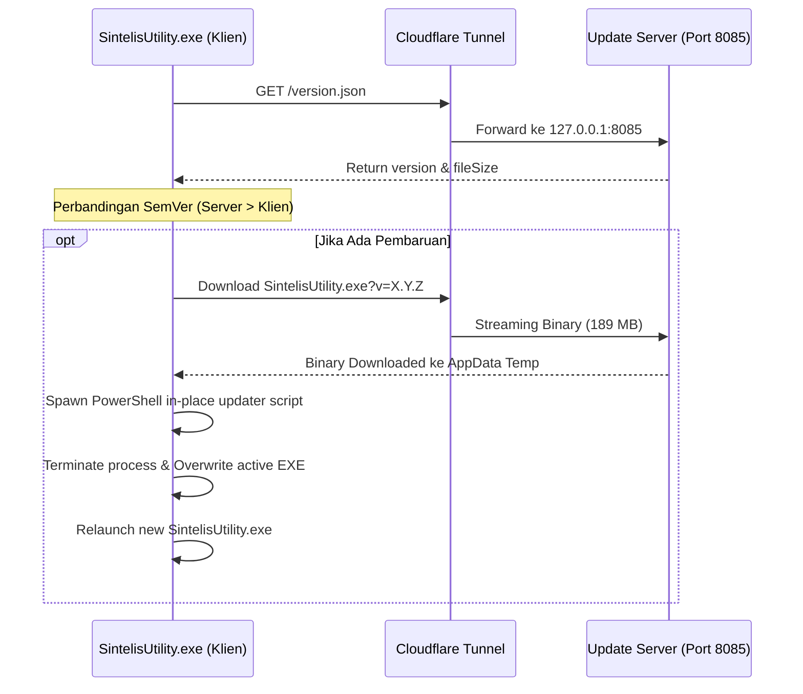

# 🏛️ ARSITEKTUR SISTEM SINTELIS UTILITY

## 1. Komponen Utama
Sistem Sintelis Utility terdiri dari tiga pilar utama:
1. **Desktop App Client (`SintelisUtility.exe`)**:
   - Frontend: React 18, Vite, Lucide Icons, NeuroNest CSS.
   - Backend Runtime: Python 3.14 embedded dengan `pywebview` / MS Edge WebView2.
   - Modul Utama:
     - Menu 1: Ganti Nama PDF Ceklis
     - Menu 2: Download P3-STE & Audit Berkas
     - Menu 3: Pipeline Foto Timemark & Galeri Interaktif
     - Menu 4: Ubah Tanggal Dokumen (Date Changer 3 Titik)
2. **Update Server (`server_update.py`)**:
   - HTTP Server Python pada Port 8085 dengan dukungan CORS lengkap.
   - Melayani endpoint `https://update.sintelboo.my.id/version.json` dan file binary rilis.
3. **Pipeline Jaringan (Cloudflare Zero Trust Tunnel)**:
   - Menghubungkan hostname publik `update.sintelboo.my.id` ke localhost port 8085 di PC Server tanpa perlu port-forwarding router publik.

## 2. Diagram Alur Pembaruan Otomatis (In-Place Auto-Update)

