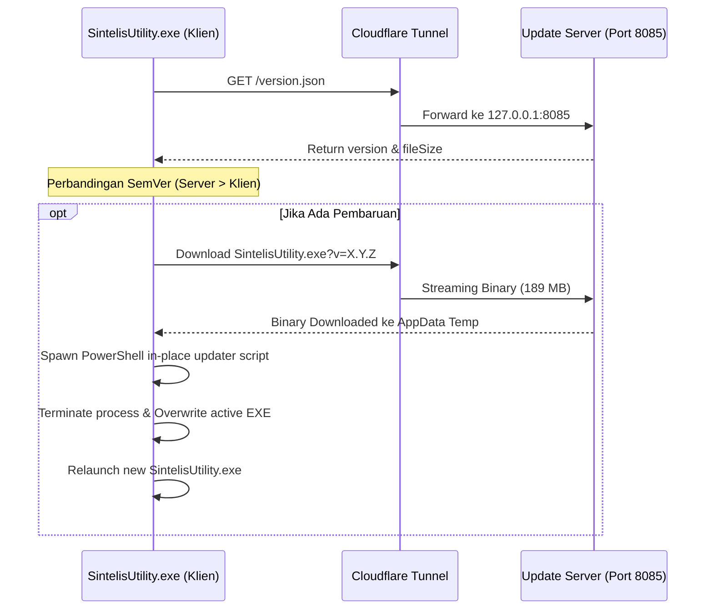
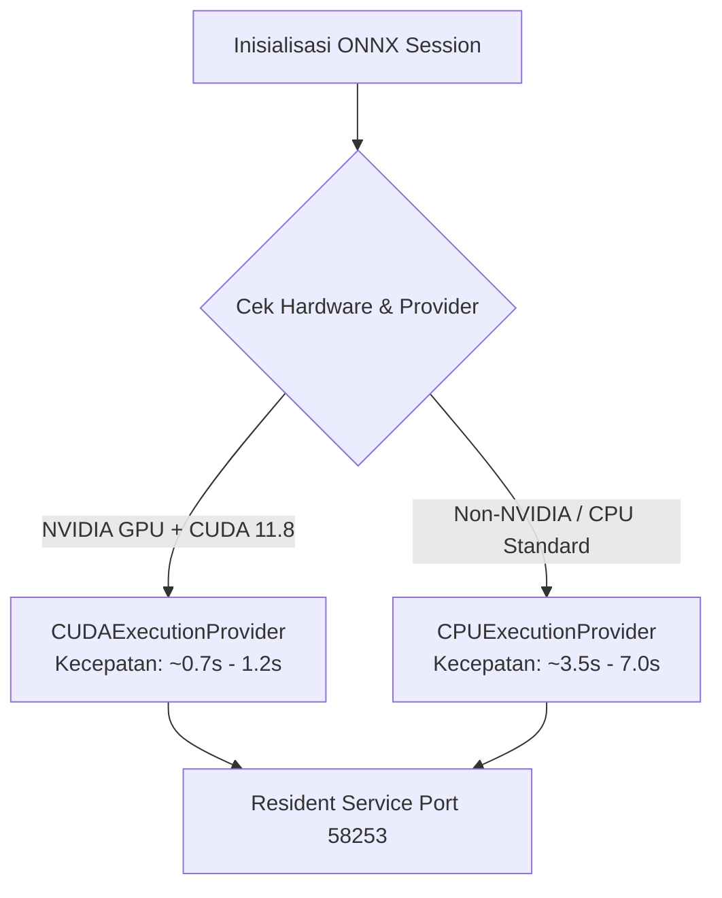

# 🏛️ ARSITEKTUR SISTEM SINTELIS UTILITY

## 1. Komponen Utama
Sistem Sintelis Utility terdiri dari tiga pilar utama:
1. **Desktop App Client (`SintelisUtility.exe`)**:
   - Frontend: React 18, Vite, Lucide Icons, NeuroNest CSS.
   - Backend Runtime: Python 3.14 embedded dengan `pywebview` / MS Edge WebView2.
   - Modul Utama:
     - Menu 1: Ganti Nama PDF Ceklis
     - Menu 2: Download P3-STE & Audit Berkas
     - Menu 3: Pipeline Foto Timemark & Galeri Interaktif
     - Menu 4: Ubah Tanggal Dokumen (Date Changer 3 Titik)
2. **Update Server (`server_update.py`)**:
   - HTTP Server Python pada Port 8085 dengan dukungan CORS lengkap.
   - Melayani endpoint `https://update.sintelboo.my.id/version.json` dan file binary rilis.
3. **Pipeline Jaringan (Cloudflare Zero Trust Tunnel)**:
   - Menghubungkan hostname publik `update.sintelboo.my.id` ke localhost port 8085 di PC Server tanpa perlu port-forwarding router publik.

## 2. Diagram Alur Pembaruan Otomatis (In-Place Auto-Update)


---

## 3. Arsitektur LaMa AI & Akselerasi Multi-Hardware
Modul Timemark memanfaatkan kecerdasan buatan (*Large Mask Inpainting / LaMa AI*) untuk menghapus teks tanggal, lokasi, dan watermark lama dari foto lapangan secara fotorealistik.

Sistem dirancang bekerja adaptif pada 2 level profil hardware:


1. **Tier 1: NVIDIA CUDA (GeForce GTX/RTX, Quadro)**
   - Pustaka: `onnxruntime-gpu==1.18.0` + CUDA 11.8 (`nvidia-cuda-runtime-cu11`) + cuDNN 8.9 (`nvidia-cudnn-cu11==8.9.5.29`).
   - Eksekusi dialihkan ke GPU VRAM (menghemat CPU dan RAM sistem).
2. **Tier 2: CPU RAM Optimized (Universal untuk AMD, Intel, dan Non-GPU)**
   - Pustaka: `onnxruntime==1.18.0` standar.
   - Menggunakan OpenMP multithreading dengan lingkungan `OMP_WAIT_POLICY=PASSIVE` agar tidak memakan CPU saat idle.
   - *Catatan Teknis*: Model LaMa AI menggunakan lapisan *Fast Fourier Convolution* (FFC) dengan tensor perkalian matriks kompleks yang belum kompatibel dengan HLSL shader DirectML (`DmlExecutionProvider` menghasilkan galat parameter MatMul `80070057`). Oleh karena itu, perangkat AMD/Intel non-NVIDIA diproses melalui CPU Execution Provider yang terbukti stabil 100%.

---

## 4. Resident Service Worker (`timemark_resident_service.py`)
Untuk menghindari *cold-start penalty* (loading model berulang yang memakan waktu 15–20 detik per foto):
- Background resident daemon dijalankan pada `127.0.0.1:58253`.
- Model PaddleOCR dan sesi ONNX (LaMa FP32/INT8) dimuat sekali ke memori saat startup aplikasi.
- Komunikasi menggunakan HTTP JSON/Base64 berkecepatan tinggi dengan sinkronisasi `threading.RLock()` re-entrant.
- **SSD Cache C:**: Model LaMa AI otomatis disalin ke `%LOCALAPPDATA%\Sintelis\models\lama_fp32.onnx` untuk kecepatan baca I/O SSD nvme instan.

---

## 5. Algoritma Sibling Consensus (Pendeteksian Watermark Kilat)
Pada foto dengan latar belakang kontras rendah (seperti foto `50.jpg` di atas batu balas rel terang):
1. Jika PaddleOCR pada foto tersebut tidak mendeteksi teks tanggal:
2. Sistem tidak melakukan polling berulang, melainkan meminjam bounding box tanggal dari saudara se-asetnya (`0.jpg` atau `100.jpg`) atau `meta.json`.
3. Foto dapat langsung diinpaint oleh LaMa AI dalam **< 1 detik** tanpa kegagalan deteksi.

---

## 6. Garbage Collection & Optimasi PDF Engine (`merge_pdf_foto.py`)
Untuk mencegah pembengkakan ukuran berkas PDF lampiran (*bloated PDF*):
- Setiap penyimpanan PDF baru maupun *re-merge* menggunakan parameter:
  ```python
  doc.save(out_path, garbage=4, deflate=True, clean=True)
  ```
- **`garbage=4`**: Membuang semua objek gambar yang tidak memiliki referensi aktif di halaman (mencegah tumpukan orphaned XObjects).
- **`deflate=True`**: Mengompresi stream berkas hingga menghemat 90%–98% ukuran file.

