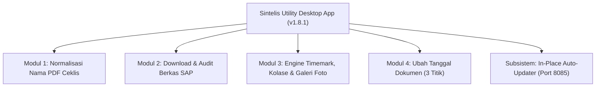
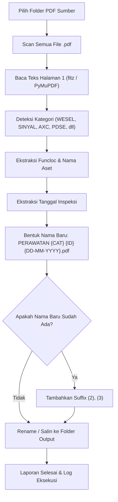
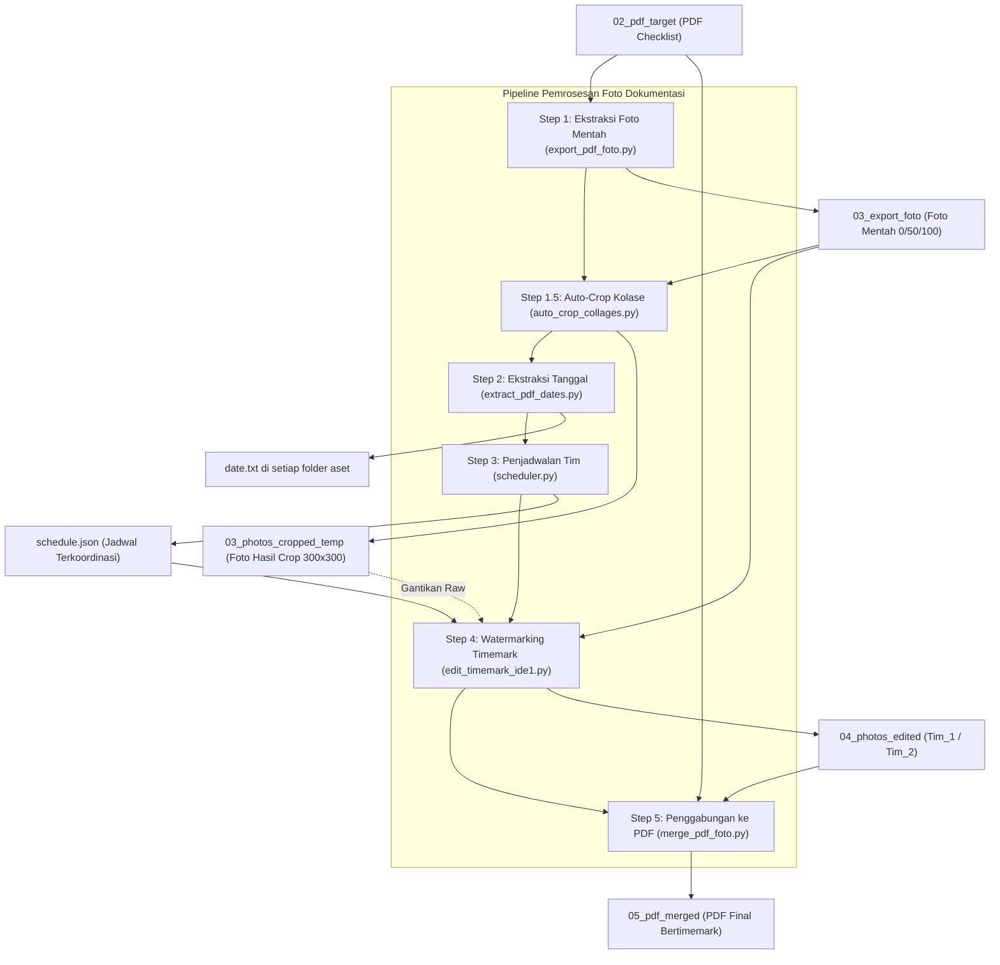
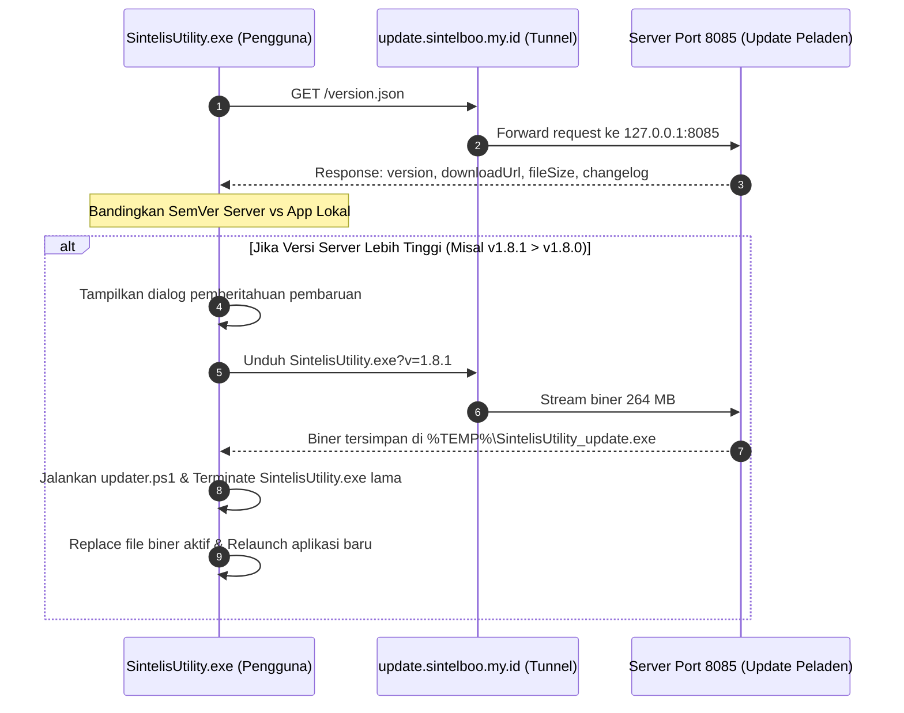
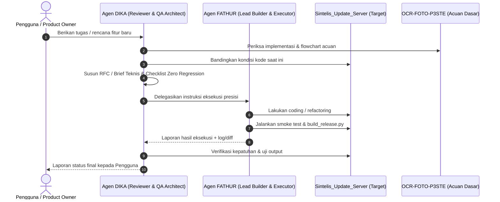

# 📚 SPESIFIKASI FITUR, FLOWCHART & ATURAN BAKU SISTEM (SINTELIS UTILITY)
> **Master Reference & Architecture Blueprint untuk Pengembangan, Pembaruan, dan Migrasi Masa Depan**  
> *Dibuat: 17 Oktober 2026 | Versi Acuan: v1.8.2 | Penulis: Antigravity AI Engineering Pair*

---

## 🎯 TUJUAN DOKUMEN INI
Dokumen ini disusun sebagai **Buku Pedoman Absolut (Single Source of Truth)** seluruh alur kerja, logika bisnis, parameter teknis, dan aturan emas per modul di dalam aplikasi Sintelis Utility. 

> [!CAUTION]
> **Peringatan Keras untuk AI Agent & Pengembang di Masa Depan:**
> Saat melakukan migrasi, refactoring, atau penambahan fitur baru, **DILARANG MENGURANGI, MENGHAPUS, ATAU MENGUBAH ALUR KONTRAK** yang ada di dokumen ini tanpa persetujuan eksplisit pengguna. Bug di masa lalu (seperti hilangnya fitur kolase, kegagalan ekspor PDSE/PTDS/PTLS, atau desinkronisasi jadwal) terjadi karena asumsi sepihak yang mengabaikan aturan bisnis di bawah ini.

---

## 🗺️ PETA MODUL UTAMA APLIKASI
Aplikasi desktop Sintelis Utility terbagi menjadi 4 modul fungsional utama dan 1 subsistem infrastruktur:



---

## 📦 MODUL 1: NORMALISASI NAMA PDF CEKLIS (RENAME PDF)

### 1.1 Deskripsi & Fungsi
Mengubah nama berkas PDF hasil unduhan SAP/arsip yang acak atau berkode mentah menjadi format standar baku sintelis:  
`PERAWATAN {KATEGORI} {IDENTIFIER} {DD-MM-YYYY}.pdf` (atau format lampiran bertanda).

### 1.2 Flowchart Alur Kerja


### 1.3 Aturan Baku Modul 1
1. **Preservasi Teks Dokumen**: Rename hanya mengubah penamaan file fisik, dilarang merusak atau mengkompresi stream isi dokumen PDF.
2. **Karakter Terlarang**: Selalu lakukan sanitasi karakter terlarang sistem berkas Windows (`/ \ : * ? " < > |`) menjadi spasi atau strip.
3. **Penanganan Multi-Inspeksi**: Jika dalam 1 tanggal terdapat lebih dari 1 file untuk aset yang sama, sistem **WAJIB** membubuhkan penomoran berurutan ` (2)`, ` (3)`.

---

## 📥 MODUL 2: DOWNLOAD & AUDIT BERKAS CHECKLIST (P3-STE)

### 2.1 Deskripsi & Fungsi
Mengintegrasikan sinkronisasi berkas perawatan dari sistem SAP / Portal web, memeriksa kelengkapan dokumen ceklis bulanan per stasiun, dan mendeteksi berkas yang hilang (*missing items*).

### 2.2 Aturan Baku Modul 2
1. **Pemetaan Stasiun ke BTP**: Selalu merujuk ke tabel pemetaan resmi:
   - `BTP JAK`: BOO (Bogor), CLT (Cilebut), JNG, JAKK, dll.
   - `BTP BD`: BOP (Bogor Paledang), BTT (Batutulis), CGB (Cigombong), COS (Cicurug), MSG (Maseng), CCR (Cicurug/Cianjur).
2. **Kelengkapan Kolom Audit**: Output audit harus menyajikan: Nama Berkas, Status Kelengkapan Foto (0%, 50%, 100%), Daftar Personil Pemeriksa, dan Tanggal Checklist.

---

## 📸 MODUL 3: TIMEMARK PIPELINE, KOLASE & GALERI FOTO (CORE ENGINE)

Modul ini merupakan inti paling kompleks dari aplikasi. Modul ini terbagi menjadi 3 pilar: **Pipeline Pemrosesan**, **Galeri Interaktif**, dan **Ekspor Laporan**.

### 3.1 Pipeline 6 Tahapan (The Complete Pipeline)


---

### 3.2 Aturan Spesifik Tiap Step Pipeline

#### 🛑 STEP 1: Ekstraksi Foto (`export_pdf_foto.py`)
1. **Deteksi Halaman Foto Berbasis pdfplumber Image Placements**:
   - Dilarang hanya mengandalkan `reader.pages[i].images` dari `pypdf` karena dokumen TCPDF menyematkan image catalog di level global yang diwariskan ke halaman tabel tanpa foto.
   - Pindai penempatan riil gambar (`placement['x0']`, `top`, `bottom`) pada halaman. Halaman foto adalah halaman dengan $\ge 3$ foto, atau yang memiliki teks `"FOTO DOKUMENTASI"`.
2. **Kategori Multi-Row vs Single-Row**:
   - `MULTI_ROW_CATEGORIES = {"SINYAL", "WESEL", "AXC"}`: Setiap baris funcloc menghasilkan folder aset tersendiri.
   - Kategori Single / Non Multi-row: `PDSE`, `PTDS`, `PTLS`, `CATUDAYA`, `CTS`, `JPL`, `PTPP`, `SERAT OPTIK`.
3. **Early Binding Multi-Inspection Auto Suffix (`_DD-MM`) & Part Suffix (`_part{n}`)**:
   - Sebelum ekstraksi, sistem menghitung kemunculan berkas `(kategori, stasiun)` via `multi_date_lookup` untuk seluruh kategori yang mungkin memiliki multi-inspeksi: `WESEL`, `PDSE`, `PTDS`, `PTLS`, `SINYAL`, `AXC`.
   - Jika suatu stasiun memiliki lebih dari 1 tanggal checklist untuk kategori yang sama dalam bulan berjalan (misal `BTT 08-01` dan `BTT 22-01`), nama folder tujuan **WAJIB** ditambahkan suffix tanggal (`BTT_08-01` dan `BTT_22-01`).
   - **Isolasi Berkas Ganda Tanggal Sama (`(2).pdf`)**: Jika terdapat berkas lampiran atau dokumen lanjutan pada hari yang sama dengan tanda ` (2).pdf`, sistem secara otomatis membubuhkan suffix partisi `_{DD-MM}_part2` (contoh: `CLT_16-02_part2` vs `CLT_16-02`) sehingga **100% bebas dari risiko saling menimpa (*zero overwrite*)**.
4. **Struktur Folder Standar 03**:
   `{export_root}/03_export_foto/{BTP}/{KATEGORI}/{IDENTIFIER}/[0.jpg, 50.jpg, 100.jpg]`

---

#### ✂️ STEP 1.5: Auto-Crop Kolase (`auto_crop_collages.py` & `crop_collage_photos.py`)
1. **Kategori Sasaran Kolase**:
   `CATUDAYA`, `CATU DAYA`, `CATU DAYA ER RADIO`, `CATU DAYA ER SINYAL`, `PDSE`, `PTDS`, `PTLS`.
2. **Metode Pemotongan Proporsional 300x300 (White-Seam Isolation)**:
   - Meredupkan warna gambar menjadi greyscale/luminance (Saturation < 8%, Brightness > 110) untuk mengisolasi garis pembatas putih/netral pemisah sub-foto.
   - Deteksi layout otomatis: 2x2 (4-in-1) atau 3-in-1 (1 Atas + 2 Bawah) dengan presisi pemotongan kuadran kiri-atas atau panel atas.
   - Hasil segmentasi disimpan ke direktori kerja sementara:  
     `{export_root}/03_photos_cropped_temp/{BTP}/{KATEGORI}/{IDENTIFIER}/[0.jpg, 50.jpg, 100.jpg]`
   - Berkas asli mentah di `03_export_foto` di-backup dengan ekstensi `.original_backup.jpg`.
3. **Manifest Pencatatan**:
   - Setiap pemotongan dicatat di `{export_root}/logs/cropped_collages.json` dan `auto_crop_manifest.json` agar galeri dan runner mengetahui status foto telah dipotong.

---

#### 📅 STEP 2: Ekstraksi Tanggal Stateless (`extract_pdf_dates.py`)
1. **Tanggung Jawab Tunggal & Stateless**:
   - Karena pemisahan folder bersuffix dan berpartisi sudah dituntaskan di Step 1 (*Early Binding*), Step 2 **dilarang melakukan manipulasi fisik copy/rename folder**. Hal ini menjaga eksekusi instan (sub-detik) dan menghapus risiko folder bertingkat (`_08-01_08-01`).
   - Step 2 murni memindai seluruh folder di `03_photos_export` (baik yang polos maupun bersuffix `_{DD-MM}` / `_{DD-MM}_part{n}`), mencocokkannya dengan tanggal dokumen PDF terkait, dan menuliskan file `date.txt` lokal.
2. **Pencarian Tanggal Multi-Layer**:
   - Layer 1: Pola tanggal pada nama berkas PDF (`(\d{2})-(\d{2})-(\d{4})`).
   - Layer 2: Pola teks tanggal berbahasa Indonesia pada lembar PDF (misal `15 Januari 2026`).
3. **Output**:
   - Dituliskan ke file teks lokal `{folder_aset}/date.txt` dalam format standar (misal `Kamis, Jan 15 2026`).
   - Folder hanya diproses jika di dalamnya terdapat file `.jpg` / `.jpeg`.

---

#### ⏱️ STEP 3: Penjadwalan Tim & Alokasi Waktu (`scheduler.py`)
1. **Sinkronisasi Suffix Multi-Date (`multi_date_lookup`)**:
   - `build_schedule` wajib menghitung kemunculan berkas PDF sebelum Pass 1 dijalankan.
   - Identifier pada `schedule.json` **WAJIB IDENTIK** dengan nama folder fisik Step 1 (misal `BTT_08-01`, `CLT_16-02_part2`, bukan nama polos).
   - Penjadwalan Pass 2 menggunakan key `(category, identifier)` sehingga file berpartisi `_part2` mendapatkan slot waktu tersendiri secara berurutan dan tidak bertumpuk dengan berkas pertama.
2. **Acuan Durasi & Mapping**:
   - Menggunakan acuan waktu dari `asset_waktu_mapping.json` dan `data_acuan_tenaga_gabungan.json`.
   - Default fallback: PDSE = 420 menit (7 jam), SERAT OPTIK = 60 menit (atau `core * 6`), WESEL = 30 menit, SINYAL = 30 menit, Kategori lainnya = 45 menit.
3. **Jam Dinas & Penjadwalan Atomik 1-File-1-Tim**:
   - Standar: Jam Mulai = `06:00` (360 menit), Batas Overlap / Jam Selesai = `18:00` (1080 menit), Tim Maksimal = `3` tim (`Tim_1`, `Tim_2`, `Tim_3`).
   - **Aturan 1 File PDF = 1 Tim Utuh:** Seluruh aset dalam 1 berkas PDF dijadwalkan pada 1 tim yang sama dan jam diteruskan berurutan dari aset pertama sampai seluruh berkas tuntas (tidak dipecah di tengah berkas dan tidak me-reset jam di tengah berkas).
   - **Pindah Tim Antar Berkas:** Jika tim aktif sudah melewati `18:00` atau tambahan durasi berkas berikutnya akan melewati `18:00`, berkas berikutnya dialihkan ke Tim berikutnya (`Tim 1 → Tim 2 → Tim 3`) mulai pukul `06:00` kembali. Jika seluruh tim telah melewati `18:00`, sistem memilih tim dengan jam akhir paling awal tanpa me-reset jam.
4. **Distribusi File Jadwal**:
   - Disimpan di root ekspor: `{export_root}/schedule.json`.
   - Disalin (*mirror*) ke folder target PDF dan folder foto mentah agar selalu ditemukan oleh backend.

---

#### 🖊️ STEP 4: Watermarking Timemark Foto (`edit_timemark_ide1.py`)
1. **Mode Detektor Timemark**:
   - **Google Cloud Vision AI (Default)**: Membaca teks watermark lama, menentukan *bounding box* presisi, dan menghapus teks lama dengan inpainting latar cerdas sebelum mencetak teks baru.
   - **HSV Garis Panduan (Fallback)**: Menggunakan deteksi koordinat garis panduan oranye/kuning pada foto.
2. **Struktur Output Foto Editan (Folder 04)**:
   - Dikelompokkan per Tim:  
     `{export_root}/04_photos_edited/Tim_{N}/{BTP}/{KATEGORI}/{IDENTIFIER}/[0.jpg, 50.jpg, 100.jpg]`
3. **Format Watermark Baru**:
   - Font: Segoe UI / Arial Bold, Warna Putih dengan outline/drop shadow hitam tipis.
   - Format teks: `{Hari}, {BulanSingkat} {DD} {YYYY} {HH}:{MM}` (Contoh: `Kamis, Jan 08 2026 07:45`).
   - Foto 0% = Waktu Mulai ($T_0$), Foto 50% = Waktu Tengah ($T_{50}$), Foto 100% = Waktu Selesai ($T_{100}$).

---

#### 📄 STEP 5: Penggabungan Kembali ke PDF (`merge_pdf_foto.py`)
1. **In-Memory Replacer**:
   - Menggantikan objek citra pada halaman dokumentasi foto PDF asli dengan citra baru bertimemark dari folder `04_photos_edited`.
2. **Output**:
   - Disimpan di folder `{export_root}/05_pdf_merged/` dengan nama yang sama dengan PDF sumber target.

---

## 🖼️ FITUR GALERI INTERAKTIF & EDITOR TIMEMARK (`GalleryPanel.jsx`)

### 4.1 Layout, Ukuran Kartu & Anti-Geser
1. **Ukuran Kartu Nyaman**:
   - Mode Tampilan Komparasi (Dual Mode 03 Mentah vs 04 Editan) dengan kartu lebar ($\ge 340\text{px}$) sehingga detail foto terlihat besar dan jelas.
   - Preview mini foto 50% dan 100% tetap tersedia di sisi bawah kartu foto utama (0%).
2. **Preview Timemark Anti-Geser (Drag & Drop)**:
   - Posisi kotak preview timemark dihitung menggunakan persentase relatif `top: (pos.y / 300) * 100%` dan `left: (pos.x / 300) * 100%`.
   - Kotak timemark **TIDAK BOLEH BERGESER** saat sidebar di-collapse, saat window di-resize, atau saat filter aktif.
3. **Sticky Freeze Filter Toolbar**:
   - Baris filter bagian atas kartu foto menggunakan posisi `position: sticky; top: 0; z-index: 40; backdrop-filter: blur(8px)`.
   - Toolbar filter tetap membeku di posisi atas saat pengguna menggulir (*scroll*) ratusan kartu foto ke bawah.

### 4.2 Lencana & Fitur Khusus Kolase di Galeri
1. **Lencana Status `🗂️ Kolase`**:
   - Ditampilkan di header kartu aset kolase (`CATUDAYA`, `PDSE`, `PTDS`, `PTLS`).
   - Berubah warna menjadi hijau `🗂️ Kolase Terpotong` jika foto hasil crop sudah ada di `03_photos_cropped_temp`.
2. **Filter Galeri Khusus Kolase**:
   - Opsi `🗂️ Hanya Foto Kolase ({jumlah})` pada dropdown filter tipe sumber foto.
3. **Tombol Potong Satuan (Single Auto-Crop `✂️`)**:
   - Mengirim request POST `/api/timemark/crop-collage-single` untuk memotong foto satuan secara instan tanpa harus mengulang seluruh pipeline.

---

## 📊 FITUR EKSPOR LAPORAN DINASAN & TABLO

### 5.1 Format Ekspor
1. **Schedule Sheet Excel (`export_schedule_excel.py`)**:
   - Menyajikan rekapitulasi seluruh jadwal per tim, stasiun, aset, waktu mulai-selesai, dan daftar personil.
2. **Tablo Perawatan Excel (`export_tablo_excel.py`)**:
   - Format matriks kalender bulanan dengan pewarnaan per tim teknisi sintelis.
3. **Dinasan Harian Excel (`export_dinasan_excel.py`)**:
   - Format surat perintah penugasan dinas harian pegawai.

---

## 🔄 SUBSISTEM AUTO-UPDATER (CLOUDFLARE ZERO TRUST TUNNEL)



### Aturan Emas Rilis Biner:
1. Target biner selalu dikompilasi via `01_scripts_pendukung/build_release.py` langsung ke `02_server_update/SintelisUtility.exe`.
2. Validasi rentang ukuran file: 170 MB – 270 MB.
3. `version.json` otomatis diperbarui dengan versi baru, ukuran byte, dan changelog terstruktur.
4. Server lokal port 8085 harus selalu dalam keadaan aktif (*listening*).

---

## 📝 CATATAN SEJARAH PERBAIKAN BUG HARI INI (17 OKTOBER 2026)

| Versi | Deskripsi Masalah | Solusi & File Terdampak |
| :--- | :--- | :--- |
| **v1.8.0** | Foto PDSE, PTDS, PTLS tidak terekspor (0 foto). | Perbaikan deteksi image placement `pdfplumber` dan penambahan suffix `_DD-MM` di `export_pdf_foto.py`. |
| **v1.8.0** | Fitur kolase hilang saat migrasi dari OCR-FOTO-P3STE. | Porting `auto_crop_collages.py`, `crop_collage_photos.py`, Step 1.5 di `pipeline_runner.py`, dan lencana kolase di `GalleryPanel.jsx`. |
| **v1.8.0** | Kotak preview timemark bergeser saat sidebar di-collapse; toolbar filter ikut tergulir. | Penggunaan koordinat persentase murni pada kotak timemark dan CSS `position: sticky; top: 0` pada filter toolbar di `GalleryPanel.jsx`. |
| **v1.8.1** | Schedule PDSE, PTDS, PTLS tidak terbuat / tidak cocok dengan folder foto. | Sinkronisasi `multi_date_lookup` di `scheduler.py` dan perbaikan path `asset_waktu_mapping.json` & `data_acuan_tenaga_gabungan.json` di `run_desktop_webview.py`. |
| **v1.8.2** | Risiko tumpang tindih berkas multi-tanggal untuk SINYAL & AXC serta berkas ganda tanggal sama `(2).pdf`; Step 2 lambat karena duplikasi folder fisik warisan ADR-013. | Perluasan Early Binding `multi_date_lookup` ke `SINYAL` & `AXC`, auto-suffix `_part{n}` untuk file `(2).pdf`, dan penyederhanaan Step 2 menjadi stateless instan di `export_pdf_foto.py`, `scheduler.py`, `merge_pdf_foto.py`, & `extract_pdf_dates.py`. |

---

## 🔬 7. KOMPARASI DETAIL PIPELINE: `OCR-FOTO-P3STE` VS `SINTELIS UTILITY DESKTOP APP`

Berikut adalah perbandingan rinci antara menu Pipeline di proyek `OCR-FOTO-P3STE` (arsitektur web Next.js) dengan `Sintelis Utility` (aplikasi desktop WebView2):

### 7.1 Perbandingan Langkah-Langkah Pipeline (Step Matrix)

| Tahap | Proyek `OCR-FOTO-P3STE` (Web App) | Proyek `Sintelis Utility` (Desktop App) | Catatan / Status Penyelarasan |
| :--- | :--- | :--- | :--- |
| **Ekstraksi Foto** | Memiliki 2 opsi terpisah di grid: <br>1. `Step 1`: Ekstraksi Stream Asli (`export_pdf_foto.py`)<br>2. `Step 1 Crop`: Crop Render 300 DPI (`--render-crop`) | Digabungkan ke dalam **`Step 1: Ekstraksi Foto PDF`** dengan auto-detect & auto-fallback placement. | Di Desktop App, mode render-crop dijalankan secara otomatis jika ekstraksi stream tidak menemukan gambar. |
| **Auto-Crop Kolase** | **`Step 1.5: Auto-Crop Kolase`** (`auto_crop_collages.py`). Memotong foto grid kolase 300x300. | **`Step 1.5: Auto-Crop Kolase (White-Seam)`** (Telah diintegrasikan per v1.8.0). | Identik 100%. Ditambah fitur Single Crop instan di Galeri. |
| **Ekstraksi Tanggal** | **`Step 2: Ekstraksi Tanggal`** (`extract_pdf_dates.py`). Mengambil tanggal target & multi-tanggal. | **`Step 2: Ekstraksi Tanggal Checklist`** (`extract_pdf_dates.py`). | Identik. Menghasilkan `date.txt` di setiap folder aset. |
| **Penjadwalan Tim** | **`Step 3: Penjadwalan Tim`** (`scheduler.py`). Membentuk `schedule.json`. | **`Step 3: Penjadwalan Tim & Alokasi Waktu`** (`scheduler.py`). | Di Desktop App telah disempurnakan dengan `multi_date_lookup` (v1.8.1). |
| **Koreksi Personil** | **`Step 3.5: Koreksi Personil`** (Tampil sebagai tombol step di grid pipeline utama). | **Dipisahkan ke Sub-Tab "Koreksi Dokumen"** (`CorrectionPanel.jsx`). | Di Desktop tidak masuk loop sekuensial pipeline otomatis, melainkan dijalankan manual via tombol audit/koreksi personil. |
| **Watermark Timemark** | **`Step 4: Edit Timemark`** (`edit_timemark_ide1.py`). Mendukung Vision & HSV. | **`Step 4: Edit Watermark Timemark Foto`**. Pilihan detektor via dropdown di awal. | Identik. Di Desktop terintegrasi drag-box preview dan inpainting background. |
| **Penggabungan PDF** | **`Step 5: Gabung PDF`** (`merge_pdf_foto.py`). | **`Step 5: Penggabungan PDF Final A4`** (`merge_pdf_foto.py`). | Identik. Di Desktop mendukung opsi *Timpa Langsung Berkas di Folder Sumber* + auto-backup. |
| **Core Serat Optik** | **`Step 6: Core Optik`** (`correct_serat_optik_cores.py`). Koreksi jumlah core JPL & OTB. | **Dipisahkan ke Sub-Tab "Koreksi Dokumen"** (`CorrectionPanel.jsx`). | Di Desktop tidak masuk loop sekuensial pipeline otomatis, melainkan dijalankan manual via tombol Koreksi Serat Optik. |

### 7.2 Perbedaan Arsitektural Lainnya:
1. **Mode Folder Sumber**:
   - `OCR-FOTO-P3STE`: Wajib 2 folder sumber kaku (`01_pdf_source` dan `02_pdf_target`).
   - `Sintelis Utility`: Menyediakan **Mode 1 Folder Tunggal** (menangani ceklis 2026 mandiri) dan **Mode 2 Folder Klasik** (komparasi 2026 vs 2025).
2. **Penanganan Multi-Tanggal (ADR-013 vs v1.8.1)**:
   - Di `OCR-FOTO-P3STE`, pemecahan folder multi-tanggal dilakukan saat Step 2 (`prepare_multi_date_folders`).
   - Di `Sintelis Utility`, penambahan suffix dilakukan lebih awal di Step 1 (`export_pdf_foto.py`) dan `scheduler.py` (Step 3) membaca pola yang sama via `multi_date_lookup`.
3. **Penyatuan Menu**:
   - `OCR-FOTO-P3STE` memecah fitur ke dalam 5 halaman web terpisah.
   - `Sintelis Utility` merangkum seluruh alur timemark menjadi 5 sub-tab di bawah 1 modul: `Pipeline`, `Schedule Sheet`, `Galeri Foto`, `Profil Pegawai`, dan `Koreksi Dokumen`.

---

## 👥 8. ARSITEKTUR DUA AGEN (TWO-AGENT COLLABORATION)

Untuk mencegah kesalahan, regresi, atau berkurangnya fitur saat pengembangan/migrasi, sistem mengadopsi pola kolaborasi dua peran sub-agen:



### 1. Agen DIKA (Reviewer & QA Architect - Read Only)
- **Acuan Dasar**: Menjadikan repositori `OCR-FOTO-P3STE` dan dokumen `Feature_Specs_and_Rules.md` sebagai patokan mutlak.
- **Tanggung Jawab**:
  - Mengaudit rancangan kode sebelum diubah.
  - Memastikan seluruh fitur (seperti Multi-Tanggal, isolasi `(2).pdf`, auto-crop kolase white-seam, durasi jadwal) terpenuhi tanpa regresi.
  - Menyusun Technical Briefing / RFC untuk dieksekusi.

### 2. Agen FATHUR (Eksekutor & Lead Builder - Read & Write)
- **Target Kerja**: Repositori `Sintelis_Update_Server`.
- **Tanggung Jawab**:
  - Menulis dan memodifikasi kode secara bedah presisi sesuai RFC dari Agen Dika.
  - Menjalankan pengujian sintaks, smoke test dataset, dan build PyInstaller `build_release.py`.
  - Melakukan sinkronisasi balik skrip ke `OCR-FOTO-P3STE/scripts/`.

---

## 🛡️ 9. ATURAN BAKU FITUR DILUAR TIMEMARK: GANTI PERSONIL & AUTO-UPDATE

### 9.1 Fitur Ganti Personil & Nomor SC (`personnel_changer_engine.py`)
1. **Dilarang Menggunakan Koordinat Hardcoded**:
   - Seluruh penempatan kotak putih (*redaction fill*) **wajib** dihitung secara dinamis dari garis fisik halaman formulir melalui `page.get_drawings()`.
2. **Aturan Inset Margin Aman**:
   - Kotak putih wajib menggunakan margin $+1.0\text{ pt}$ (kiri & atas) dan $-1.0\text{ pt}$ (kanan & bawah) dari garis sel fisik agar tidak menimpa garis pembatas sel.
3. **Standar Tipografi Form KAI**:
   - Font wajib menggunakan `DejaVuSans-Bold` (bukan `Helvetica`).
   - Argumen `fontname='DejaVuSans-Bold'` wajib disertakan bersamaan dengan `fontfile` pada PyMuPDF `insert_text`.
   - Ukuran font standar: **7.8 pt** untuk Nama Personil, **7.0 pt** untuk Nomor SC.

### 9.2 Fitur Auto-Update Client (`updater_engine.py`)
1. **Dilarang Menggunakan Flag `/T` pada `taskkill`**:
   - Updater `cmd.exe` dilahirkan oleh proses aplikasi Python. Penggunaan flag `/T` (*tree kill*) akan membunuh `cmd.exe` itu sendiri sebelum sempat menimpa biner atau me-restart aplikasi.
2. **Dilarang Menggunakan `timeout` pada Non-Interactive Shell**:
   - Jeda waktu dalam skrip batch latar belakang wajib menggunakan `ping 127.0.0.1 -n {detik + 1} >nul`.
3. **Isolasi Proses Penuh via Shell RPC (VBScript Wrapper)**:
   - Peluncuran skrip updater wajib dibungkus VBScript tersembunyi (*window style 0*) dan dijalankan via `os.startfile(vbs_file)`. Pemanggilan didelegasikan ke `explorer.exe` (Windows Shell RPC) sehingga independen mutlak dari siklus hidup Python.
4. **UX Auto-Restart & Reopen**:
   - Begitu unduhan selesai (100%), antarmuka webview wajib memicu otomatis proses pemasangan dan memuat ulang aplikasi ke versi terbaru tanpa memerlukan intervensi tombol manual berulang dari pengguna.


---

## 🏷️ 9. ATURAN RESOLUSI ALIAS NAMA BERKAS ARSIP (BIDIRECTIONAL ALIAS MAPPING)

Untuk menjembatani perbedaan antara kode aset master modern dan nama berkas fisik arsip historis (seperti arsip 2025 yang membawa typo atau penamaan lama lapangan), sistem memberlakukan aturan pemetaan alias dua arah:

| Berkas Lapangan (Arsip 2025) | Aset Master Sintelis | Lingkup Isolasi | Penanganan Engine |
| :--- | :--- | :--- | :--- |
| `PERAWATAN SINYAL J12B MSG ...` | `SINYAL J12 MSG` | Khusus Stasiun `MSG` | `matchFileToAsset`, `idMatches`, `IDENTIFIER_EXCEPTIONS`, `merge_pdf_foto.py` |
| `PERAWATAN AXLE COUNTER ZP 41B BOO ...` | `AXLE COUNTER ZP 41 BOO` | Khusus Stasiun `BOO` | `matchFileToAsset`, `idMatches`, `IDENTIFIER_EXCEPTIONS`, `merge_pdf_foto.py` |
| `PERAWATAN PTLS MSG ...` | `PTLS MSG` (Target: 1) | Stasiun `MSG` | Diselaraskan seragam dengan stasiun BTP BD lainnya (`target: 1`) |

> [!WARNING]
> **Prinsip Isolasi Alias:** Aturan alias `J12B` $\leftrightarrow$ `J12` **HANYA** berlaku jika lokasi terdeteksi sebagai `MSG`. Stasiun `CLT` dan `BTT` memiliki sinyal keluar `J12A` dan `J12B` terpisah secara fisik sehingga tidak boleh dialiaskan sembarangan!

---

## 🔤 10. STANDAR BAKU TIPOGRAFI & INJEKSI FONT (DEJAVUSANS-BOLD 7.2 PT)

Seluruh checklist perawatan P3STE dibuat menggunakan pustaka TCPDF dengan format font embedded **`DejaVuSans-Bold`**. Seluruh mesin yang melakukan manipulasi teks (seperti `personnel_changer_engine.py` dan `date_changer_engine.py`) wajib menaati aturan berikut:

1. **Dilarang Keras Hardcode `Helvetica-Bold`:**
   PyMuPDF merender `Helvetica-Bold` dengan bentuk tipis dan sempit yang menimbulkan kontras visual jomplang (*belang*) terhadap teks tabel asli.
2. **Wajib Menyematkan Berkas `fontfile`:**
   Setiap pemanggilan `page.insert_text(...)` wajib menyertakan path berkas `DejaVuSans-Bold.ttf` via parameter `fontfile=font_file` untuk mencegah eksepsi `ValueError: font is unsupported`.
3. **Penguncian Titik Baseline `origin`:**
   Hindari penghitungan posisi Y manual `(bbox.y1 - 1.5)`. Selalu gunakan titik tipografi bawaan `target_span.get("origin")` agar teks pengganti duduk persis di garis baris yang sama dengan teks aslinya.
4. **Ukuran Standar Font:**
   - Tanggal Halaman 1: **`7.2 pt`** (DejaVuSans-Bold)
   - Tanggal Header Foto: **`7.2 pt`** (DejaVuSans-Bold, rata tengah kanvas via `custom_font.text_length(...)`)
   - Nama Personil: **`7.8 pt`** (DejaVuSans-Bold)
   - No. SC Personil: **`7.0 pt`** (DejaVuSans-Bold)


---

## 🗂️ 11. ATURAN SINGLE LOCATION FOLDER & MAPPING JSON (MULTI-ASSET CHECKLIST)

Untuk checklist dokumen yang memuat banyak baris aset dalam 1 lokasi stasiun yang sama (contohnya **Catu Daya, PDSE, Serat Optik, PTDS, PTLS, JPL, PTPP**):

1. **Folder Foto Tunggal per Lokasi:**
   - Folder ekspor foto mentah (`03_photos_export`) dan foto hasil edit (`04_photos_edited`) **TIDAK DIBAGI PER BARIS ASET**, melainkan hanya 1 folder per lokasi/stasiun (misal: `BTP BD/CATUDAYA/CGB/`). Hal ini dirancang agar pengguna tidak perlu mengedit foto yang sama berulang kali di folder berbeda.
2. **Kamus Pemetaan Berkas (`asset_location_mapping.json`):**
   - Disimpan di root folder ekspor foto dan folder logs.
   - Menyimpan pemetaan multi-indeks: `by_location`, `asset_to_location`, `pdf_to_location`, dan `pdf_to_assets`.
3. **Penanganan Penggabungan Dokumen (`merge_pdf_foto.py`):**
   - Saat menyisipkan foto ke dokumen PDF yang memuat lebih dari 1 baris funcloc, sistem mengambil foto dari folder lokasi yang terdaftar pada `asset_location_mapping.json`.
   - Jika suatu baris aset tidak memiliki foto khusus, foto diduplikasi secara otomatis dari baris pertama dokumen tersebut (`photo_paths[identifier] = first_found_photos`).
4. **Isolasi Penuh Kategori Multi-Row Murni:**
   - Kategori yang memang memiliki unit foto fisik berbeda per baris aset (**`WESEL`**, **`SINYAL`**, **`AXC`**) dikecualikan secara ketat (`MULTI_ROW_CATEGORIES`) dan tetap menggunakan alur foto per nomor aset (misal: `W11`, `11A`, `ZP 41`).

---

## 🖱️ 12. STANDAR INTERAKSI DRAG-AND-DROP & PERSISTENSI TIMEMARK BOX

1. **Anti-Flicker Drag Over (CSS `pointer-events: none`):**
   - Seluruh overlay visual penanda drag (seperti `isDragOver` dengan warna amber pada kartu galeri) **wajib** memiliki properti CSS `pointerEvents: 'none'`. Hal ini mencegah pointer mouse melakukan hit-testing pada overlay yang memicu loop tak berujung `dragleave` ↔ `dragenter`.
   - Event `onDragLeave` wajib memiliki penjaga boundary kontainer:
     `if (e.currentTarget.contains(e.relatedTarget)) return;`.
2. **Sticky Timemark Coordinates (`lastTimemarkPos`):**
   - Posisi koordinat penanda timemark (`xPos`, `yPos`) yang disesuaikan pengguna pada salah satu foto wajib dipertahankan ke dalam sesi aktif dan `localStorage` (`sintelis_last_timemark_pos`).
   - Saat pengguna melakukan penggantian foto via drag-and-drop:
     - Frontend mengirim koordinat terakhir `lastTimemarkPos` ke endpoint `/api/timemark/replace-photo`.
     - Backend memprioritaskan koordinat tersebut dan mengoper parameter `--x-override` dan `--y-override` ke engine `edit_timemark_ide1.py` dengan flag `--ignore-manual`.
     - Metadata `meta.json` diperbarui secara serentak di folder output primer dan alternatif.

---

## 🚫 13. ATURAN KERJA AI: DILARANG AUTO-BUILD (MANUAL BUILD OLEH USER)

> [!CAUTION]
> **Wajib Ditaati oleh Seluruh Sesi Chat & AI Agent (Antigravity):**
> Setelah AI menyelesaikan pengubahan kode, penambahan fitur, atau perbaikan bug:
> 1. **Dilarang mengeksekusi otomatis:** `build_and_deploy.bat`, `python build_release.py`, atau PyInstaller.
> 2. **AI hanya boleh memverifikasi frontend:** menjalankan `npm run build` untuk memeriksa tidak ada galat sintaks/JSX.
> 3. **Eksekusi build diserahkan kepada User:** Biarkan user yang mengeksekusi `build_and_deploy.bat` secara manual guna mencegah bentrok (*file lock / race condition*) antar sesi chat yang berjalan simultan.


---

## 🗓️ 14. FITUR GANTI TANGGAL FOTO ARSIP (BATCH DATE EDITOR PER FOLDER ASET)

Fitur ini dirancang bagi pengguna yang telah menyimpan hasil ekstraksi foto inspeksi dari beberapa bulan lalu dan hanya ingin memperbarui tanggal watermark tanpa perlu menjalankan pipeline lengkap dari awal:

1. **Pemilihan Folder Bebas (Input & Output):**
   - **Folder Sumber Foto**: Pengguna dapat memilih direktori arsip foto mana pun. Sistem secara otomatis mendeteksi struktur folder aset (`BTP / KATEGORI / IDENTIFIER`) dan file foto di dalamnya (`0.jpg`, `50.jpg`, `100.jpg`).
   - **Folder Tujuan Simpan**: Pengguna dapat menentukan lokasi direktori penyimpanan hasil editan baru.
2. **Sistem Centang Berbasis Folder Aset (Folder-Level Selection):**
   - Checkbox centang diletakkan pada header bar folder aset (misal: `[☑️] BTP BD / PDSE / BTT (3 Foto)`).
   - Seluruh foto di dalam folder tersebut otomatis terpilih dan diproses bersamaan, menghemat waktu pemilihan pengguna.
3. **Panel Kanan (Sticky Right Sidebar):**
   - Memuat box input tanggal kalender (*DatePicker*) yang otomatis diformat ke standar bahasa Indonesia (misal: `Jumat, Nov 06 2026`).
   - **Tanpa Jam**: Tanggal dicetak murni pada foto menggunakan flag `--no-time` di `edit_timemark_ide1.py` tanpa membuat *schedule*.
   - Daftar folder tercentang dapat ditinjau dan dibatalkan per folder dengan tombol `[❌]`.
4. **Backend Endpoint:**
   - Melayani endpoint `/api/timemark/batch-update-date` yang memproses watermarking secara sekuensial dengan inpainting Google Cloud Vision / HSV fallback.


---

## 🧭 15. ARSITEKTUR KOTAK TIMEMARK INTERAKTIF & ISOLASI KOORDINAT PER-FOTO

Fitur draggable timemark box memungkinkan penyesuaian posisi watermark langsung pada kartu galeri (*inline*) maupun modal. Untuk mencegah anomali visual dan desinkronisasi antar-foto, aturan berikut wajib ditaati:

1. **Aturan Baku Larangan Pengosongan DOM Style (`boxRef.current.style.top = ''`):**
   - **Penyebab Bug "Box Mental ke Tengah (50%)":** Sesuai spesifikasi W3C CSS Flexbox, elemen berposisi `absolute` di dalam kontainer flex (`align-items: center` & `justify-content: center`) yang nilai `top`/`left`-nya dikosongkan (`''` / `auto`) akan secara instan ditarik paksa ke titik tengah (50% X & 50% Y).
   - **Aturan Solusi:** Dilarang mengosongkan style ke string kosong `''`. Nilai `style.top` dan `style.left` wajib selalu dipasang secara eksplisit berbasis persentase:
     ```javascript
     if (boxRef.current) {
       boxRef.current.style.left = `${(normX / 300) * 100}%`;
       boxRef.current.style.top = `${(normY / 300) * 100}%`;
     }
     ```
2. **Isolasi State Koordinat Mandiri per Foto (`photoCoordsMap`):**
   - Menghindari ketergantungan pada variabel global `lastTimemarkPos` saat merender foto yang sudah memiliki riwayat edit.
   - Menggunakan peta koordinat per `targetKey` (`${relDir}/${photoName}`):
     ```javascript
     const [photoCoordsMap, setPhotoCoordsMap] = useState({});
     ```
   - Setiap foto (`Foto 0%`, `Foto 50%`, `Foto 100%`) mengunci koordinatnya secara independen. Mengedit Foto 50 atau Foto 100 **tidak boleh dan tidak akan pernah** mengubah posisi Foto 0 kembali ke tengah.
3. **Penguncian Dimensi Bounding Box 1:1 (`display: inline-block`):**
   - Pembungkus gambar (`img-wrapper`) wajib menggunakan `display: inline-block` (bukan `inline-flex`) dengan `lineHeight: 0`.
   - Perhitungan drag (*Pointer Event*) mengukur dimensi rendered elemen `` secara langsung (`imgEl.clientWidth` & `imgEl.clientHeight`) agar rasio skala `0 - 300` presisi 1:1 dengan parameter `--y-override` dan `--x-override` pada engine Python.
4. **Isolasi Modal Editor (`applyToFolder = false`):**
   - Opsi *"Terapkan ke seluruh foto dalam folder ini"* (`applyToFolder`) pada `TimemarkEditorModal` maupun `BatchTimemarkEditorModal` **wajib diset default `false`**.
   - Menyimpan revisi pada 1 foto tidak boleh menimpa koordinat foto lainnya di folder yang sama kecuali jika pengguna secara sadar mencentang checkbox tersebut.

---

## ⚡ 16. OPTIMALISASI RUANG VISUAL GALERI (ULTRA-COMPACT HEADER & COLLAPSIBLE FILTER)

Untuk memaksimalkan area kerja peninjauan foto inspeksi di layar desktop:

1. **Ultra-Compact Bento Header:**
   - Header utama aplikasi (`BentoHeader.jsx`) mendukung mode ciut (*collapsed*) dengan tinggi ramping (~38px) dibandingkan mode penuh (~125px).
   - Menyediakan tombol *toggle* `[Detail ▼]` / `[Ciutkan Header ▲]`.
   - Preferensi pengguna disimpan permanen di `localStorage` (`sintelis_bento_collapsed`).
2. **Single-Row Toolbar Galeri (~44px):**
   - Menyatukan pemilih folder sumber, path, tombol refresh, counter status kelengkapan, toggle mode tampilan (`✨ 04`, `📷 03 & ✨ 04`, `📷 03`), ukuran kartu (`Fokus` / `Standar`), dan pemilih detektor (`Google Vision AI` / `Metode Biasa`) dalam satu baris horizontal yang hemat ruang.
3. **Collapsible Filter Bar (`[⚡ Filter]`):**
   - Bar filter target PDF, stasiun, kategori aset, kelengkapan, dan pencarian teks disembunyikan secara default (0px *overhead* vertikal).
   - Dibuka via tombol `[⚡ Filter]` yang menampilkan badge jumlah filter aktif dan tombol reset cepat.

---

## 🚀 17. FAST TARGETED REFRESH (PENANGANAN JARINGAN LAMBAT / NETWORK DRIVE)

Saat foto disimpan di Network Drive (misal drive `Z:\...`), operasi pemindaian ulang seluruh folder (`fetchPhotos()`) memakan waktu lama dan menyebabkan *lag* yang signifikan.

1. **Mekanisme Single Photo Refresh (`refreshSinglePhotoCard`):**
   - Setelah operasi edit timemark tunggal selesai, frontend memanggil fungsi `refreshSinglePhotoCard(targetKey, newMeta)` alih-alih me-reload seluruh direktori.
   - Hanya memperbarui satu objek foto di memori state React secara instan.
   - Menginjeksi parameter timestamp cache buster `?_v=${Date.now()}` khusus pada URL foto tersebut agar browser langsung menampilkan hasil gambar terbaru dari backend tanpa mengganggu foto lainnya di layar.


---

## 🔬 18. MULTI-COLUMN & SINGLE-COLUMN ADAPTIVE OTB/JPL CORE CORRECTION

Pembaruan engine koreksi nilai Jumlah Core Serat Optik & OTB (`correct_serat_optik_cores.py` & `CorrectionPanel.jsx`):

### 18.1 Master Database Spek Core
- Sumber master: `otb_core_database.json` (terintegrasi ke dalam paket build PyInstaller).
- Aturan pencarian aset:
  1. Dicocokkan berdasarkan Funloc / Kode TRA (misal `TRA11799` = 48, `TRA11803` = 12, `TRA11830` = 24).
  2. Dicocokkan berdasarkan Nama Aset OTB normalisasi.
  3. Aset di luar database:
     - Jika teridentifikasi berkas/aset **JPL**: Default = **12**.
     - Jika teridentifikasi berkas/aset **Stasiun** (BOP, BTT, COS, MSG, CGB, dll.): Default = **24**.
- Format output nilai: **Hanya Angka** (misal: `"48"`, `"24"`, `"12"`), tanpa kata tambahan `"Core"`.

### 18.2 Grid Matematika Kolom Tabel & Perataan Presisi (Neighbor Alignment)
Batas outline tabel vertikal kanan terkunci di $X = 565.65\text{ pt}$ dan lebar setiap kolom $48.61\text{ pt}$.
Engine mendeteksi jumlah kolom $N \in [1, 5]$ dan menghitung koordinat kolom ke-$k$ ($M = N - 1 - k$):
- $X_1 = 565.65 - (M \times 48.61)$
- $X_0 = X_1 - 48.61$
- Posisi X Angka 2-digit: $X_{\text{origin}} = 537.14 - (M \times 48.61)$
- **Perataan Vertikal (Baseline Y):** Engine mendeteksi garis dasar teks angka asli tetangga pada baris 1.2 ($x > 320$, misal TRA11863 & TRA11830 dengan $Y = 376.00$), lalu menggunakan $Y$ baseline tersebut sehingga seluruh angka dalam baris 1.2 rata sejajar secara horizontal sempurna tanpa bergelombang.

### 18.3 True PDF Redaction Presisi Dua Tahap
Untuk mencegah bug PyMuPDF `need font file or buffer` saat modifikasi stream:
1. Tahap 1: Daftarkan seluruh annotasi redaksi aman dengan margin 1.5 pt dari garis batas:
   `Rect(col_x0 + 1.5, row_y0 - 2.5, col_x1 - 1.5, row_y1 + 2.5)`.
2. Tahap 2: Terapkan redaksi secara batch (`apply_redactions()`).
3. Tahap 3: Sisipkan font `DejaVuSans.ttf` (7.202 pt, regular) *setelah* redaksi selesai.
4. Tahap 4: Tulis teks angka rata tengah di $X = X_{\text{center}} - (\text{text\_w} / 2)$.
5. Berkas PDF disimpan ke berkas sementara lalu ditimpa secara atomik ke berkas asli dengan cadangan otomatis ke folder `backups/`.


## 📅 19. EKSPOR & IMPOR JADWAL EKSTERNAL (SCHEDULE.JSON) UNTUK SUBSET / PARSIAL FILE

Fitur ini menjawab kebutuhan pengguna ketika ingin memproses sebagian kecil berkas PDF (misal hanya 5 berkas perbaikan), di mana penjadwalan satu bulan penuh (Step 3) tidak dapat/tidak perlu dihitung ulang dari awal:

### 19.1 Alur Kerja (Workflow)
1. **Ekspor Jadwal Bulanan (`schedule.json`):**
   - Di tab **Schedule Sheet**, pengguna meninjau matriks jadwal bulanan (hasil Step 3 atau *Buat Schedule Otomatis*).
   - Pengguna mengklik tombol **`💾 Ekspor schedule.json`** di bilah atas samping tombol Excel.
   - Dialog *Save As* native Windows muncul dan pengguna dapat menyimpan `schedule.json` di direktori yang diinginkan (misal `D:\Jadwal\schedule_mei_2025.json`).
2. **Impor Jadwal di Pipeline Proses:**
   - Di tab **Pipeline Proses**, ketika memproses folder yang hanya berisi beberapa berkas PDF (misal 5 berkas):
   - Pengguna mencentang opsi **`📅 Gunakan Jadwal Tersimpan / Eksternal (schedule.json)`**.
   - Pengguna menekan tombol **`📄 Pilih...`** dan memilih berkas `schedule.json` yang telah diekspor sebelumnya.
   - Panel antarmuka memvalidasi berkas secara instan via endpoint `/api/timemark/schedule-info` dan menampilkan ringkasan jumlah aset dan hari kerja.
3. **Eksekusi Pipeline Parsial:**
   - **Step 1:** Ekstraksi foto PDF untuk 5 berkas saja.
   - **Step 1.5:** Auto-crop kolase berjalan normal.
   - **Step 2:** Ekstraksi tanggal checklist berjalan normal.
   - **Step 3 (Penjadwalan):** **Dilewati secara otomatis (*bypassed*)**, karena tanggal, jam dinas, dan tim kerja langsung diambil dari `schedule.json` eksternal.
   - **Step 4 (Watermark Timemark):** `edit_timemark_ide1.py` langsung membaca aset-aset pada 5 berkas tersebut dari `schedule.json` eksternal dan mencetak tanggal serta jam secara akurat.
   - **Step 5 (Penggabungan PDF):** `merge_pdf_foto.py` menggabungkan 5 berkas tersebut dengan foto hasil edit berstempel akurat.


## 🔌 20. ATURAN JAM DINAS & FOTO MULTI-ASET (SERAT OPTIK, PDSE, CATUDAYA)

Pembaruan engine alokasi jam kerja dinas dan pemisahan foto mandiri per baris aset (`scheduler.py`, `export_pdf_foto.py`, `merge_pdf_foto.py`):

### 20.1 Formula Durasi Waktu Per Kategori
1. **Serat Optik (OTB & JPL):**
   - Rumus: $\text{Durasi} = \text{Jumlah Core} \times 6\text{ menit}$.
   - Jumlah core dibaca dinamis per-baris aset dari master `otb_core_database.json` (berdasarkan kode TRA / Funloc atau nama OTB).
   - Nilai default bila tidak ada di database:
     - Berkas/aset JPL: **12 Core** ($12 \times 6 = 72\text{ menit}$).
     - Berkas/aset Stasiun: **24 Core** ($24 \times 6 = 144\text{ menit}$).
   - Contoh nyata (OTB 1-5 ER Bogor 28-05-2025):
     - OTB 1 (48 Core): 288 menit (08:30 s.d 13:18) -> Tim 1
     - OTB 4 (24 Core): 144 menit (08:30 s.d 10:54) -> Tim 2 (wrap karena Tim 1 melebihi 15:30)
     - OTB 5 (24 Core): 144 menit (10:54 s.d 13:18) -> Tim 2
     - OTB 2 (24 Core): 144 menit (13:18 s.d 15:42) -> Tim 2
     - OTB 3 (48 Core): 288 menit (15:42 s.d 20:30) -> Tim 2
2. **PDSE:**
   - Standar harian: **420 menit** (08:30 s.d 15:30).
   - Jika dalam satu hari terdapat $K$ baris aset PDSE, durasi dibagi rata: $\text{Durasi} = \max(15, \text{round}(420 / K))$.
3. **Catudaya:**
   - Standar dinas: **45 menit** per aset.

### 20.2 Alokasi Multi-Tim (Tim 1 & Tim 2)
- Jam dinas normal dimulai pukul `08:30` (menit ke-510) dan selesai pukul `15:30` (menit ke-930).
- Jika $\text{clock} + \text{durasi} > 930$ dan tim saat ini masih di bawah `tim_max` (Tim 1):
  - Sistem otomatis mengalihkan aset berikutnya ke **Tim 2** pada tanggal yang sama mulai pukul **08:30**.
  - Jika sudah berada di Tim 2 (`tim == tim_max`), jam terus berlanjut tanpa membuat tim fiktif baru.

### 20.3 Pemisahan Folder Foto Per-Aset (Photo Splitting)
Ketika opsi *Bagi Foto & Jam Sesuai Jumlah Baris Aset* (`split_multi_asset`) aktif:
1. `export_pdf_foto.py` mengekstrak foto ke folder lokasi dasar (`ER SINYAL BOO`) DAN menduplikasikannya ke folder masing-masing aset (`OTB 1 ER BOGOR`, `OTB 2 ER BOGOR`, dst.).
2. `edit_timemark_ide1.py` mencap stempel watermark foto per folder aset dengan tanggal, jam, dan Tim yang sesuai dari `schedule.json`.
3. `merge_pdf_foto.py` memprioritaskan folder spesifik aset terlebih dahulu saat menyematkan foto ke tabel baris lampiran PDF.

---

## 21. SPESIFIKASI AKSELERASI HARDWARE MULTI-DEVICE & OPTIMASI PDF

### 21.1 Aturan Pemindaian Perangkat (Hardware Profiling)
Aplikasi dan AI Agent wajib mendukung fleksibilitas instalasi di berbagai lingkungan PC (laptop dinas, PC kantor, PC server) dengan opsi setup:
1. **Opsi 1 (NVIDIA GPU / CUDA 11.8)**: Pilihan utama untuk PC ber-GPU NVIDIA (GTX 1050 atau lebih baru). Memproses foto ~0.7s - 1.2s per foto dengan `onnxruntime-gpu==1.18.0`.
2. **Opsi 2 (CPU & RAM Saja / PC Standar & GPU Non-NVIDIA AMD/Intel)**: Untuk PC kantor standar tanpa GPU dedicated atau PC ber-GPU AMD/Intel. Kecepatan ~3.5s - 7.0s per foto dengan `onnxruntime==1.18.0`.
   > [!WARNING] Catatan Status DirectML:
   > Operator Fast Fourier Convolution (FFC) pada model LaMa Inpainting memiliki operasi tensor frekuensi yang belum didukung oleh shader HLSL DirectX 12 DirectML (akan crash dengan galat `DmlExecutionProvider 80070057`). Oleh karena itu, kode aktual di `edit_timemark_ide1.py` dan `timemark_resident_service.py` secara baku disetel `providers = ['CUDAExecutionProvider', 'CPUExecutionProvider']`. Jangan menambahkan `DmlExecutionProvider` untuk LaMa tanpa pengujian stabilitas menyeluruh.

Skrip pemindaian dan instalasi otomatis tersedia di `01_scripts_pendukung/setup_ai_hardware.py`.

### 21.2 Pencegahan Kebocoran Memori & Bloat PDF (Garbage Collection)
1. **PDF Saving Standard**: Setiap operasi simpan dokumen PDF di `merge_pdf_foto.py` wajib menyertakan flag `garbage=4, deflate=True, clean=True`. Hal ini mencegah penumpukan objek gambar lama (*orphaned XObjects*) yang menyebabkan dokumen membengkak hingga puluhan atau ratusan megabyte.
2. **OpenMP & CPU Threading**: Lingkungan subprocess runtime selalu mengekspor `OMP_WAIT_POLICY=PASSIVE` dan `KMP_BLOCKTIME=0` untuk memastikan proses inferensi tidak memakan CPU di latar belakang saat idle.

---

## 22. LOGIKA EDIT & MANAJEMEN FOTO TERAKHIR (NOVEMBER 2026)

### 22.1 Isolasi Reset Per-Aset di Folder 04 (`04_photos_edited`)
Pada saat user menjalankan ulang (*rerun*) Step 4 untuk satu aset/kategori tertentu (misal hanya `SERAT OPTIK`), skrip `edit_timemark_ide1.py` mengumpulkan seluruh folder aset dari `all_jpgs` di `03_export_foto`. Sebelum memproses ulang, sistem menghapus folder aset lama tersebut di seluruh subfolder tim (`Tim_1` s.d `Tim_4` dan root) pada `04_photos_edited`. Dengan begitu:
- Aset yang sedang diproses ulang bersih dari meta/foto lama antar-tim.
- Kategori dan aset lain di `04_photos_edited` tetap utuh (tidak di-reset total).

### 22.2 Mencegah Pembuatan Folder Duplikat `Tim_1`..`Tim_4` Secara Otomatis
Pada fungsi sinkronisasi backend (`_handle_timemark_process_single` dan `_handle_timemark_replace_photo` di `run_desktop_webview.py`), penyalinan file ke folder tim alternatif (`alt_outs`) hanya dieksekusi jika folder tim tersebut sudah ada secara fisik sebelumnya (`os.path.isdir(target_dir)`). Perintah `os.makedirs(target_dir, exist_ok=True)` dihapus agar folder tim kosong tidak terbuat secara paksa pada proyek dengan struktur direktori direct (tanpa pembagian tim).

### 22.3 Native Drag & Drop pada WebView2
- **Backend:** `run_desktop_webview.py` mengikat `win.dom.document.events.drop += DOMEventHandler(_on_native_drop, prevent_default=True, stop_propagation=False)`. Mengatur `prevent_default=True` wajib dilakukan agar WebView2 mengizinkan pembacaan `pywebviewFullPath` saat file PDF atau folder di-drop dari Windows Explorer, lalu memancarkan event `sintelis-native-drop`.
- **Frontend Gating:** Prop `isActive` diteruskan berjenjang dari `App.jsx` -> `DateChangerPanel.jsx` (`isActive && activeSubTab === 'date'`) -> `PersonnelChangerSubTab.jsx` (`isActive && activeSubTab === 'personnel'`). Event listener hanya merespons saat tab/sub-tab aktif agar berkas tidak salah masuk ke sub-tab lain.

### 22.4 Personil Beda Tanggal di "Ubah Personil & No. SC"
Tab `PersonnelChangerSubTab.jsx` mendukung konfigurasi personil berbeda per tanggal. User dapat memilih pill `🌐 Semua Tanggal (Default)` atau memilih tanggal spesifik `📅 DD-MM-YYYY` untuk mengeset personil khusus tanggal tersebut. Backend `/api/personnel-changer/apply` menerima payload array `items` yang berisi daftar `employees` per berkas PDF.


