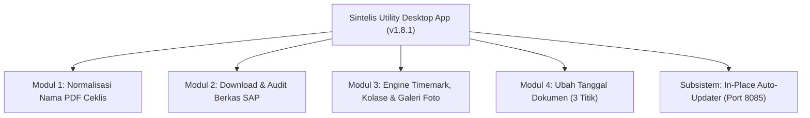
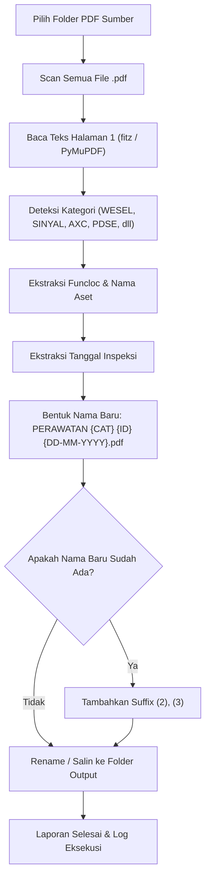
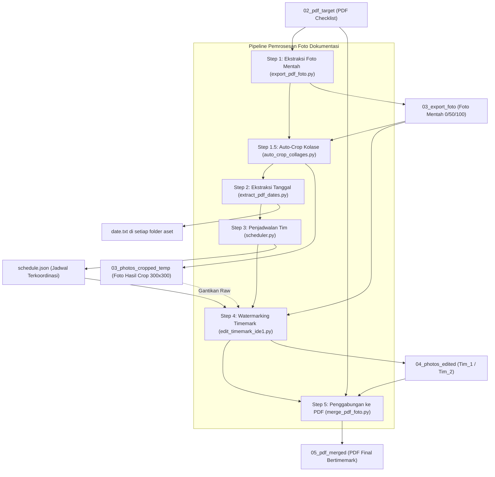
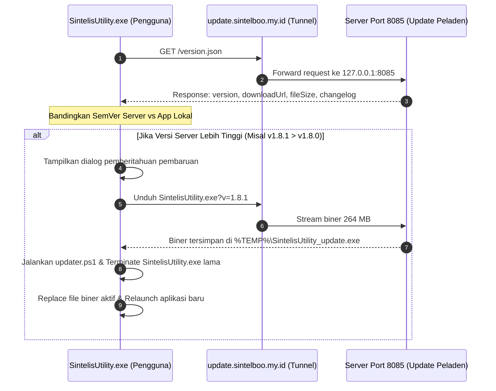
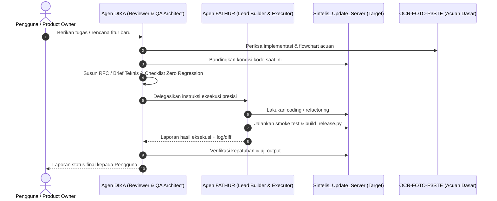

# 📚 SPESIFIKASI FITUR, FLOWCHART & ATURAN BAKU SISTEM (SINTELIS UTILITY)
> **Master Reference & Architecture Blueprint untuk Pengembangan, Pembaruan, dan Migrasi Masa Depan**  
> *Dibuat: 17 Oktober 2026 | Versi Acuan: v1.8.2 | Penulis: Antigravity AI Engineering Pair*

---

## 🎯 TUJUAN DOKUMEN INI
Dokumen ini disusun sebagai **Buku Pedoman Absolut (Single Source of Truth)** seluruh alur kerja, logika bisnis, parameter teknis, dan aturan emas per modul di dalam aplikasi Sintelis Utility. 

> [!CAUTION]
> **Peringatan Keras untuk AI Agent & Pengembang di Masa Depan:**
> Saat melakukan migrasi, refactoring, atau penambahan fitur baru, **DILARANG MENGURANGI, MENGHAPUS, ATAU MENGUBAH ALUR KONTRAK** yang ada di dokumen ini tanpa persetujuan eksplisit pengguna. Bug di masa lalu (seperti hilangnya fitur kolase, kegagalan ekspor PDSE/PTDS/PTLS, atau desinkronisasi jadwal) terjadi karena asumsi sepihak yang mengabaikan aturan bisnis di bawah ini.

---

## 🗺️ PETA MODUL UTAMA APLIKASI
Aplikasi desktop Sintelis Utility terbagi menjadi 4 modul fungsional utama dan 1 subsistem infrastruktur:

---

## 📦 MODUL 1: NORMALISASI NAMA PDF CEKLIS (RENAME PDF)

### 1.1 Deskripsi & Fungsi
Mengubah nama berkas PDF hasil unduhan SAP/arsip yang acak atau berkode mentah menjadi format standar baku sintelis:  
`PERAWATAN {KATEGORI} {IDENTIFIER} {DD-MM-YYYY}.pdf` (atau format lampiran bertanda).

### 1.2 Flowchart Alur Kerja

### 1.3 Aturan Baku Modul 1
1. **Preservasi Teks Dokumen**: Rename hanya mengubah penamaan file fisik, dilarang merusak atau mengkompresi stream isi dokumen PDF.
2. **Karakter Terlarang**: Selalu lakukan sanitasi karakter terlarang sistem berkas Windows (`/ \ : * ? " < > |`) menjadi spasi atau strip.
3. **Penanganan Multi-Inspeksi**: Jika dalam 1 tanggal terdapat lebih dari 1 file untuk aset yang sama, sistem **WAJIB** membubuhkan penomoran berurutan ` (2)`, ` (3)`.

---

## 📥 MODUL 2: DOWNLOAD & AUDIT BERKAS CHECKLIST (P3-STE)

### 2.1 Deskripsi & Fungsi
Mengintegrasikan sinkronisasi berkas perawatan dari sistem SAP / Portal web, memeriksa kelengkapan dokumen ceklis bulanan per stasiun, dan mendeteksi berkas yang hilang (*missing items*).

### 2.2 Aturan Baku Modul 2
1. **Pemetaan Stasiun ke BTP**: Selalu merujuk ke tabel pemetaan resmi:
   - `BTP JAK`: BOO (Bogor), CLT (Cilebut), JNG, JAKK, dll.
   - `BTP BD`: BOP (Bogor Paledang), BTT (Batutulis), CGB (Cigombong), COS (Cicurug), MSG (Maseng), CCR (Cicurug/Cianjur).
2. **Kelengkapan Kolom Audit**: Output audit harus menyajikan: Nama Berkas, Status Kelengkapan Foto (0%, 50%, 100%), Daftar Personil Pemeriksa, dan Tanggal Checklist.

---

## 📸 MODUL 3: TIMEMARK PIPELINE, KOLASE & GALERI FOTO (CORE ENGINE)

Modul ini merupakan inti paling kompleks dari aplikasi. Modul ini terbagi menjadi 3 pilar: **Pipeline Pemrosesan**, **Galeri Interaktif**, dan **Ekspor Laporan**.

### 3.1 Pipeline 6 Tahapan (The Complete Pipeline)

---

### 3.2 Aturan Spesifik Tiap Step Pipeline

#### 🛑 STEP 1: Ekstraksi Foto (`export_pdf_foto.py`)
1. **Deteksi Halaman Foto Berbasis pdfplumber Image Placements**:
   - Dilarang hanya mengandalkan `reader.pages[i].images` dari `pypdf` karena dokumen TCPDF menyematkan image catalog di level global yang diwariskan ke halaman tabel tanpa foto.
   - Pindai penempatan riil gambar (`placement['x0']`, `top`, `bottom`) pada halaman. Halaman foto adalah halaman dengan $\ge 3$ foto, atau yang memiliki teks `"FOTO DOKUMENTASI"`.
2. **Kategori Multi-Row vs Single-Row**:
   - `MULTI_ROW_CATEGORIES = {"SINYAL", "WESEL", "AXC"}`: Setiap baris funcloc menghasilkan folder aset tersendiri.
   - Kategori Single / Non Multi-row: `PDSE`, `PTDS`, `PTLS`, `CATUDAYA`, `CTS`, `JPL`, `PTPP`, `SERAT OPTIK`.
3. **Early Binding Multi-Inspection Auto Suffix (`_DD-MM`) & Part Suffix (`_part{n}`)**:
   - Sebelum ekstraksi, sistem menghitung kemunculan berkas `(kategori, stasiun)` via `multi_date_lookup` untuk seluruh kategori yang mungkin memiliki multi-inspeksi: `WESEL`, `PDSE`, `PTDS`, `PTLS`, `SINYAL`, `AXC`.
   - Jika suatu stasiun memiliki lebih dari 1 tanggal checklist untuk kategori yang sama dalam bulan berjalan (misal `BTT 08-01` dan `BTT 22-01`), nama folder tujuan **WAJIB** ditambahkan suffix tanggal (`BTT_08-01` dan `BTT_22-01`).
   - **Isolasi Berkas Ganda Tanggal Sama (`(2).pdf`)**: Jika terdapat berkas lampiran atau dokumen lanjutan pada hari yang sama dengan tanda ` (2).pdf`, sistem secara otomatis membubuhkan suffix partisi `_{DD-MM}_part2` (contoh: `CLT_16-02_part2` vs `CLT_16-02`) sehingga **100% bebas dari risiko saling menimpa (*zero overwrite*)**.
4. **Struktur Folder Standar 03**:
   `{export_root}/03_export_foto/{BTP}/{KATEGORI}/{IDENTIFIER}/[0.jpg, 50.jpg, 100.jpg]`

---

#### ✂️ STEP 1.5: Auto-Crop Kolase (`auto_crop_collages.py` & `crop_collage_photos.py`)
1. **Kategori Sasaran Kolase**:
   `CATUDAYA`, `CATU DAYA`, `CATU DAYA ER RADIO`, `CATU DAYA ER SINYAL`, `PDSE`, `PTDS`, `PTLS`.
2. **Metode Pemotongan Proporsional 300x300 (White-Seam Isolation)**:
   - Meredupkan warna gambar menjadi greyscale/luminance (Saturation < 8%, Brightness > 110) untuk mengisolasi garis pembatas putih/netral pemisah sub-foto.
   - Deteksi layout otomatis: 2x2 (4-in-1) atau 3-in-1 (1 Atas + 2 Bawah) dengan presisi pemotongan kuadran kiri-atas atau panel atas.
   - Hasil segmentasi disimpan ke direktori kerja sementara:  
     `{export_root}/03_photos_cropped_temp/{BTP}/{KATEGORI}/{IDENTIFIER}/[0.jpg, 50.jpg, 100.jpg]`
   - Berkas asli mentah di `03_export_foto` di-backup dengan ekstensi `.original_backup.jpg`.
3. **Manifest Pencatatan**:
   - Setiap pemotongan dicatat di `{export_root}/logs/cropped_collages.json` dan `auto_crop_manifest.json` agar galeri dan runner mengetahui status foto telah dipotong.

---

#### 📅 STEP 2: Ekstraksi Tanggal Stateless (`extract_pdf_dates.py`)
1. **Tanggung Jawab Tunggal & Stateless**:
   - Karena pemisahan folder bersuffix dan berpartisi sudah dituntaskan di Step 1 (*Early Binding*), Step 2 **dilarang melakukan manipulasi fisik copy/rename folder**. Hal ini menjaga eksekusi instan (sub-detik) dan menghapus risiko folder bertingkat (`_08-01_08-01`).
   - Step 2 murni memindai seluruh folder di `03_photos_export` (baik yang polos maupun bersuffix `_{DD-MM}` / `_{DD-MM}_part{n}`), mencocokkannya dengan tanggal dokumen PDF terkait, dan menuliskan file `date.txt` lokal.
2. **Pencarian Tanggal Multi-Layer**:
   - Layer 1: Pola tanggal pada nama berkas PDF (`(\d{2})-(\d{2})-(\d{4})`).
   - Layer 2: Pola teks tanggal berbahasa Indonesia pada lembar PDF (misal `15 Januari 2026`).
3. **Output**:
   - Dituliskan ke file teks lokal `{folder_aset}/date.txt` dalam format standar (misal `Kamis, Jan 15 2026`).
   - Folder hanya diproses jika di dalamnya terdapat file `.jpg` / `.jpeg`.

---

#### ⏱️ STEP 3: Penjadwalan Tim & Alokasi Waktu (`scheduler.py`)
1. **Sinkronisasi Suffix Multi-Date (`multi_date_lookup`)**:
   - `build_schedule` wajib menghitung kemunculan berkas PDF sebelum Pass 1 dijalankan.
   - Identifier pada `schedule.json` **WAJIB IDENTIK** dengan nama folder fisik Step 1 (misal `BTT_08-01`, `CLT_16-02_part2`, bukan nama polos).
   - Penjadwalan Pass 2 menggunakan key `(category, identifier)` sehingga file berpartisi `_part2` mendapatkan slot waktu tersendiri secara berurutan dan tidak bertumpuk dengan berkas pertama.
2. **Acuan Durasi & Mapping**:
   - Menggunakan acuan waktu dari `asset_waktu_mapping.json` dan `data_acuan_tenaga_gabungan.json`.
   - Default fallback: PDSE = 420 menit (7 jam), SERAT OPTIK = 60 menit (atau `core * 6`), WESEL = 30 menit, SINYAL = 30 menit, Kategori lainnya = 45 menit.
3. **Jam Dinas**:
   - Standar: Jam Mulai = 07:00, Jam Selesai = 18:00, Tim Maksimal = 2 tim (`Tim_1`, `Tim_2`).
   - Jika slot waktu melebihi batas jam selesai, tugas dialihkan ke `Tim 2` mulai pukul 07:00 kembali.
4. **Distribusi File Jadwal**:
   - Disimpan di root ekspor: `{export_root}/schedule.json`.
   - Disalin (*mirror*) ke folder target PDF dan folder foto mentah agar selalu ditemukan oleh backend.

---

#### 🖊️ STEP 4: Watermarking Timemark Foto (`edit_timemark_ide1.py`)
1. **Mode Detektor Timemark**:
   - **Google Cloud Vision AI (Default)**: Membaca teks watermark lama, menentukan *bounding box* presisi, dan menghapus teks lama dengan inpainting latar cerdas sebelum mencetak teks baru.
   - **HSV Garis Panduan (Fallback)**: Menggunakan deteksi koordinat garis panduan oranye/kuning pada foto.
2. **Struktur Output Foto Editan (Folder 04)**:
   - Dikelompokkan per Tim:  
     `{export_root}/04_photos_edited/Tim_{N}/{BTP}/{KATEGORI}/{IDENTIFIER}/[0.jpg, 50.jpg, 100.jpg]`
3. **Format Watermark Baru**:
   - Font: Segoe UI / Arial Bold, Warna Putih dengan outline/drop shadow hitam tipis.
   - Format teks: `{Hari}, {BulanSingkat} {DD} {YYYY} {HH}:{MM}` (Contoh: `Kamis, Jan 08 2026 07:45`).
   - Foto 0% = Waktu Mulai ($T_0$), Foto 50% = Waktu Tengah ($T_{50}$), Foto 100% = Waktu Selesai ($T_{100}$).

---

#### 📄 STEP 5: Penggabungan Kembali ke PDF (`merge_pdf_foto.py`)
1. **In-Memory Replacer**:
   - Menggantikan objek citra pada halaman dokumentasi foto PDF asli dengan citra baru bertimemark dari folder `04_photos_edited`.
2. **Output**:
   - Disimpan di folder `{export_root}/05_pdf_merged/` dengan nama yang sama dengan PDF sumber target.

---

## 🖼️ FITUR GALERI INTERAKTIF & EDITOR TIMEMARK (`GalleryPanel.jsx`)

### 4.1 Layout, Ukuran Kartu & Anti-Geser
1. **Ukuran Kartu Nyaman**:
   - Mode Tampilan Komparasi (Dual Mode 03 Mentah vs 04 Editan) dengan kartu lebar ($\ge 340\text{px}$) sehingga detail foto terlihat besar dan jelas.
   - Preview mini foto 50% dan 100% tetap tersedia di sisi bawah kartu foto utama (0%).
2. **Preview Timemark Anti-Geser (Drag & Drop)**:
   - Posisi kotak preview timemark dihitung menggunakan persentase relatif `top: (pos.y / 300) * 100%` dan `left: (pos.x / 300) * 100%`.
   - Kotak timemark **TIDAK BOLEH BERGESER** saat sidebar di-collapse, saat window di-resize, atau saat filter aktif.
3. **Sticky Freeze Filter Toolbar**:
   - Baris filter bagian atas kartu foto menggunakan posisi `position: sticky; top: 0; z-index: 40; backdrop-filter: blur(8px)`.
   - Toolbar filter tetap membeku di posisi atas saat pengguna menggulir (*scroll*) ratusan kartu foto ke bawah.

### 4.2 Lencana & Fitur Khusus Kolase di Galeri
1. **Lencana Status `🗂️ Kolase`**:
   - Ditampilkan di header kartu aset kolase (`CATUDAYA`, `PDSE`, `PTDS`, `PTLS`).
   - Berubah warna menjadi hijau `🗂️ Kolase Terpotong` jika foto hasil crop sudah ada di `03_photos_cropped_temp`.
2. **Filter Galeri Khusus Kolase**:
   - Opsi `🗂️ Hanya Foto Kolase ({jumlah})` pada dropdown filter tipe sumber foto.
3. **Tombol Potong Satuan (Single Auto-Crop `✂️`)**:
   - Mengirim request POST `/api/timemark/crop-collage-single` untuk memotong foto satuan secara instan tanpa harus mengulang seluruh pipeline.

---

## 📊 FITUR EKSPOR LAPORAN DINASAN & TABLO

### 5.1 Format Ekspor
1. **Schedule Sheet Excel (`export_schedule_excel.py`)**:
   - Menyajikan rekapitulasi seluruh jadwal per tim, stasiun, aset, waktu mulai-selesai, dan daftar personil.
2. **Tablo Perawatan Excel (`export_tablo_excel.py`)**:
   - Format matriks kalender bulanan dengan pewarnaan per tim teknisi sintelis.
3. **Dinasan Harian Excel (`export_dinasan_excel.py`)**:
   - Format surat perintah penugasan dinas harian pegawai.

---

## 🔄 SUBSISTEM AUTO-UPDATER (CLOUDFLARE ZERO TRUST TUNNEL)

### Aturan Emas Rilis Biner:
1. Target biner selalu dikompilasi via `01_scripts_pendukung/build_release.py` langsung ke `02_server_update/SintelisUtility.exe`.
2. Validasi rentang ukuran file: 170 MB – 270 MB.
3. `version.json` otomatis diperbarui dengan versi baru, ukuran byte, dan changelog terstruktur.
4. Server lokal port 8085 harus selalu dalam keadaan aktif (*listening*).

---

## 📝 CATATAN SEJARAH PERBAIKAN BUG HARI INI (17 OKTOBER 2026)

| Versi | Deskripsi Masalah | Solusi & File Terdampak |
| :--- | :--- | :--- |
| **v1.8.0** | Foto PDSE, PTDS, PTLS tidak terekspor (0 foto). | Perbaikan deteksi image placement `pdfplumber` dan penambahan suffix `_DD-MM` di `export_pdf_foto.py`. |
| **v1.8.0** | Fitur kolase hilang saat migrasi dari OCR-FOTO-P3STE. | Porting `auto_crop_collages.py`, `crop_collage_photos.py`, Step 1.5 di `pipeline_runner.py`, dan lencana kolase di `GalleryPanel.jsx`. |
| **v1.8.0** | Kotak preview timemark bergeser saat sidebar di-collapse; toolbar filter ikut tergulir. | Penggunaan koordinat persentase murni pada kotak timemark dan CSS `position: sticky; top: 0` pada filter toolbar di `GalleryPanel.jsx`. |
| **v1.8.1** | Schedule PDSE, PTDS, PTLS tidak terbuat / tidak cocok dengan folder foto. | Sinkronisasi `multi_date_lookup` di `scheduler.py` dan perbaikan path `asset_waktu_mapping.json` & `data_acuan_tenaga_gabungan.json` di `run_desktop_webview.py`. |
| **v1.8.2** | Risiko tumpang tindih berkas multi-tanggal untuk SINYAL & AXC serta berkas ganda tanggal sama `(2).pdf`; Step 2 lambat karena duplikasi folder fisik warisan ADR-013. | Perluasan Early Binding `multi_date_lookup` ke `SINYAL` & `AXC`, auto-suffix `_part{n}` untuk file `(2).pdf`, dan penyederhanaan Step 2 menjadi stateless instan di `export_pdf_foto.py`, `scheduler.py`, `merge_pdf_foto.py`, & `extract_pdf_dates.py`. |

---

## 🔬 7. KOMPARASI DETAIL PIPELINE: `OCR-FOTO-P3STE` VS `SINTELIS UTILITY DESKTOP APP`

Berikut adalah perbandingan rinci antara menu Pipeline di proyek `OCR-FOTO-P3STE` (arsitektur web Next.js) dengan `Sintelis Utility` (aplikasi desktop WebView2):

### 7.1 Perbandingan Langkah-Langkah Pipeline (Step Matrix)

| Tahap | Proyek `OCR-FOTO-P3STE` (Web App) | Proyek `Sintelis Utility` (Desktop App) | Catatan / Status Penyelarasan |
| :--- | :--- | :--- | :--- |
| **Ekstraksi Foto** | Memiliki 2 opsi terpisah di grid:  1. `Step 1`: Ekstraksi Stream Asli (`export_pdf_foto.py`) 2. `Step 1 Crop`: Crop Render 300 DPI (`--render-crop`) | Digabungkan ke dalam **`Step 1: Ekstraksi Foto PDF`** dengan auto-detect & auto-fallback placement. | Di Desktop App, mode render-crop dijalankan secara otomatis jika ekstraksi stream tidak menemukan gambar. |
| **Auto-Crop Kolase** | **`Step 1.5: Auto-Crop Kolase`** (`auto_crop_collages.py`). Memotong foto grid kolase 300x300. | **`Step 1.5: Auto-Crop Kolase (White-Seam)`** (Telah diintegrasikan per v1.8.0). | Identik 100%. Ditambah fitur Single Crop instan di Galeri. |
| **Ekstraksi Tanggal** | **`Step 2: Ekstraksi Tanggal`** (`extract_pdf_dates.py`). Mengambil tanggal target & multi-tanggal. | **`Step 2: Ekstraksi Tanggal Checklist`** (`extract_pdf_dates.py`). | Identik. Menghasilkan `date.txt` di setiap folder aset. |
| **Penjadwalan Tim** | **`Step 3: Penjadwalan Tim`** (`scheduler.py`). Membentuk `schedule.json`. | **`Step 3: Penjadwalan Tim & Alokasi Waktu`** (`scheduler.py`). | Di Desktop App telah disempurnakan dengan `multi_date_lookup` (v1.8.1). |
| **Koreksi Personil** | **`Step 3.5: Koreksi Personil`** (Tampil sebagai tombol step di grid pipeline utama). | **Dipisahkan ke Sub-Tab "Koreksi Dokumen"** (`CorrectionPanel.jsx`). | Di Desktop tidak masuk loop sekuensial pipeline otomatis, melainkan dijalankan manual via tombol audit/koreksi personil. |
| **Watermark Timemark** | **`Step 4: Edit Timemark`** (`edit_timemark_ide1.py`). Mendukung Vision & HSV. | **`Step 4: Edit Watermark Timemark Foto`**. Pilihan detektor via dropdown di awal. | Identik. Di Desktop terintegrasi drag-box preview dan inpainting background. |
| **Penggabungan PDF** | **`Step 5: Gabung PDF`** (`merge_pdf_foto.py`). | **`Step 5: Penggabungan PDF Final A4`** (`merge_pdf_foto.py`). | Identik. Di Desktop mendukung opsi *Timpa Langsung Berkas di Folder Sumber* + auto-backup. |
| **Core Serat Optik** | **`Step 6: Core Optik`** (`correct_serat_optik_cores.py`). Koreksi jumlah core JPL & OTB. | **Dipisahkan ke Sub-Tab "Koreksi Dokumen"** (`CorrectionPanel.jsx`). | Di Desktop tidak masuk loop sekuensial pipeline otomatis, melainkan dijalankan manual via tombol Koreksi Serat Optik. |

### 7.2 Perbedaan Arsitektural Lainnya:
1. **Mode Folder Sumber**:
   - `OCR-FOTO-P3STE`: Wajib 2 folder sumber kaku (`01_pdf_source` dan `02_pdf_target`).
   - `Sintelis Utility`: Menyediakan **Mode 1 Folder Tunggal** (menangani ceklis 2026 mandiri) dan **Mode 2 Folder Klasik** (komparasi 2026 vs 2025).
2. **Penanganan Multi-Tanggal (ADR-013 vs v1.8.1)**:
   - Di `OCR-FOTO-P3STE`, pemecahan folder multi-tanggal dilakukan saat Step 2 (`prepare_multi_date_folders`).
   - Di `Sintelis Utility`, penambahan suffix dilakukan lebih awal di Step 1 (`export_pdf_foto.py`) dan `scheduler.py` (Step 3) membaca pola yang sama via `multi_date_lookup`.
3. **Penyatuan Menu**:
   - `OCR-FOTO-P3STE` memecah fitur ke dalam 5 halaman web terpisah.
   - `Sintelis Utility` merangkum seluruh alur timemark menjadi 5 sub-tab di bawah 1 modul: `Pipeline`, `Schedule Sheet`, `Galeri Foto`, `Profil Pegawai`, dan `Koreksi Dokumen`.

---

## 👥 8. ARSITEKTUR DUA AGEN (TWO-AGENT COLLABORATION)

Untuk mencegah kesalahan, regresi, atau berkurangnya fitur saat pengembangan/migrasi, sistem mengadopsi pola kolaborasi dua peran sub-agen:

### 1. Agen DIKA (Reviewer & QA Architect - Read Only)
- **Acuan Dasar**: Menjadikan repositori `OCR-FOTO-P3STE` dan dokumen `Feature_Specs_and_Rules.md` sebagai patokan mutlak.
- **Tanggung Jawab**:
  - Mengaudit rancangan kode sebelum diubah.
  - Memastikan seluruh fitur (seperti Multi-Tanggal, isolasi `(2).pdf`, auto-crop kolase white-seam, durasi jadwal) terpenuhi tanpa regresi.
  - Menyusun Technical Briefing / RFC untuk dieksekusi.

### 2. Agen FATHUR (Eksekutor & Lead Builder - Read & Write)
- **Target Kerja**: Repositori `Sintelis_Update_Server`.
- **Tanggung Jawab**:
  - Menulis dan memodifikasi kode secara bedah presisi sesuai RFC dari Agen Dika.
  - Menjalankan pengujian sintaks, smoke test dataset, dan build PyInstaller `build_release.py`.
  - Melakukan sinkronisasi balik skrip ke `OCR-FOTO-P3STE/scripts/`.

---

## 🛡️ 9. ATURAN BAKU FITUR DILUAR TIMEMARK: GANTI PERSONIL & AUTO-UPDATE

### 9.1 Fitur Ganti Personil & Nomor SC (`personnel_changer_engine.py`)
1. **Dilarang Menggunakan Koordinat Hardcoded**:
   - Seluruh penempatan kotak putih (*redaction fill*) **wajib** dihitung secara dinamis dari garis fisik halaman formulir melalui `page.get_drawings()`.
2. **Aturan Inset Margin Aman**:
   - Kotak putih wajib menggunakan margin $+1.0\text{ pt}$ (kiri & atas) dan $-1.0\text{ pt}$ (kanan & bawah) dari garis sel fisik agar tidak menimpa garis pembatas sel.
3. **Standar Tipografi Form KAI**:
   - Font wajib menggunakan `DejaVuSans-Bold` (bukan `Helvetica`).
   - Argumen `fontname='DejaVuSans-Bold'` wajib disertakan bersamaan dengan `fontfile` pada PyMuPDF `insert_text`.
   - Ukuran font standar: **7.8 pt** untuk Nama Personil, **7.0 pt** untuk Nomor SC.

### 9.2 Fitur Auto-Update Client (`updater_engine.py`)
1. **Dilarang Menggunakan Flag `/T` pada `taskkill`**:
   - Updater `cmd.exe` dilahirkan oleh proses aplikasi Python. Penggunaan flag `/T` (*tree kill*) akan membunuh `cmd.exe` itu sendiri sebelum sempat menimpa biner atau me-restart aplikasi.
2. **Dilarang Menggunakan `timeout` pada Non-Interactive Shell**:
   - Jeda waktu dalam skrip batch latar belakang wajib menggunakan `ping 127.0.0.1 -n {detik + 1} >nul`.
3. **Isolasi Proses Penuh via Shell RPC (VBScript Wrapper)**:
   - Peluncuran skrip updater wajib dibungkus VBScript tersembunyi (*window style 0*) dan dijalankan via `os.startfile(vbs_file)`. Pemanggilan didelegasikan ke `explorer.exe` (Windows Shell RPC) sehingga independen mutlak dari siklus hidup Python.
4. **UX Auto-Restart & Reopen**:
   - Begitu unduhan selesai (100%), antarmuka webview wajib memicu otomatis proses pemasangan dan memuat ulang aplikasi ke versi terbaru tanpa memerlukan intervensi tombol manual berulang dari pengguna.

---

## 🏷️ 9. ATURAN RESOLUSI ALIAS NAMA BERKAS ARSIP (BIDIRECTIONAL ALIAS MAPPING)

Untuk menjembatani perbedaan antara kode aset master modern dan nama berkas fisik arsip historis (seperti arsip 2025 yang membawa typo atau penamaan lama lapangan), sistem memberlakukan aturan pemetaan alias dua arah:

| Berkas Lapangan (Arsip 2025) | Aset Master Sintelis | Lingkup Isolasi | Penanganan Engine |
| :--- | :--- | :--- | :--- |
| `PERAWATAN SINYAL J12B MSG ...` | `SINYAL J12 MSG` | Khusus Stasiun `MSG` | `matchFileToAsset`, `idMatches`, `IDENTIFIER_EXCEPTIONS`, `merge_pdf_foto.py` |
| `PERAWATAN AXLE COUNTER ZP 41B BOO ...` | `AXLE COUNTER ZP 41 BOO` | Khusus Stasiun `BOO` | `matchFileToAsset`, `idMatches`, `IDENTIFIER_EXCEPTIONS`, `merge_pdf_foto.py` |
| `PERAWATAN PTLS MSG ...` | `PTLS MSG` (Target: 1) | Stasiun `MSG` | Diselaraskan seragam dengan stasiun BTP BD lainnya (`target: 1`) |

> [!WARNING]
> **Prinsip Isolasi Alias:** Aturan alias `J12B` $\leftrightarrow$ `J12` **HANYA** berlaku jika lokasi terdeteksi sebagai `MSG`. Stasiun `CLT` dan `BTT` memiliki sinyal keluar `J12A` dan `J12B` terpisah secara fisik sehingga tidak boleh dialiaskan sembarangan!

---

## 🔤 10. STANDAR BAKU TIPOGRAFI & INJEKSI FONT (DEJAVUSANS-BOLD 7.2 PT)

Seluruh checklist perawatan P3STE dibuat menggunakan pustaka TCPDF dengan format font embedded **`DejaVuSans-Bold`**. Seluruh mesin yang melakukan manipulasi teks (seperti `personnel_changer_engine.py` dan `date_changer_engine.py`) wajib menaati aturan berikut:

1. **Dilarang Keras Hardcode `Helvetica-Bold`:**
   PyMuPDF merender `Helvetica-Bold` dengan bentuk tipis dan sempit yang menimbulkan kontras visual jomplang (*belang*) terhadap teks tabel asli.
2. **Wajib Menyematkan Berkas `fontfile`:**
   Setiap pemanggilan `page.insert_text(...)` wajib menyertakan path berkas `DejaVuSans-Bold.ttf` via parameter `fontfile=font_file` untuk mencegah eksepsi `ValueError: font is unsupported`.
3. **Penguncian Titik Baseline `origin`:**
   Hindari penghitungan posisi Y manual `(bbox.y1 - 1.5)`. Selalu gunakan titik tipografi bawaan `target_span.get("origin")` agar teks pengganti duduk persis di garis baris yang sama dengan teks aslinya.
4. **Ukuran Standar Font:**
   - Tanggal Halaman 1: **`7.2 pt`** (DejaVuSans-Bold)
   - Tanggal Header Foto: **`7.2 pt`** (DejaVuSans-Bold, rata tengah kanvas via `custom_font.text_length(...)`)
   - Nama Personil: **`7.8 pt`** (DejaVuSans-Bold)
   - No. SC Personil: **`7.0 pt`** (DejaVuSans-Bold)

---

## 🚫 11. ATURAN KERJA AI: DILARANG AUTO-BUILD (MANUAL BUILD OLEH USER)

> [!CAUTION]
> **Wajib Ditaati oleh Seluruh Sesi Chat & AI Agent (Antigravity):**
> Setelah AI menyelesaikan pengubahan kode, penambahan fitur, atau perbaikan bug:
> 1. **Dilarang mengeksekusi otomatis:** `build_and_deploy.bat`, `python build_release.py`, atau PyInstaller.
> 2. **AI hanya boleh memverifikasi frontend:** menjalankan `npm run build` untuk memeriksa tidak ada galat sintaks/JSX.
> 3. **Eksekusi build diserahkan kepada User:** Biarkan user yang mengeksekusi `build_and_deploy.bat` secara manual guna mencegah bentrok (*file lock / race condition*) antar sesi chat yang berjalan simultan.
